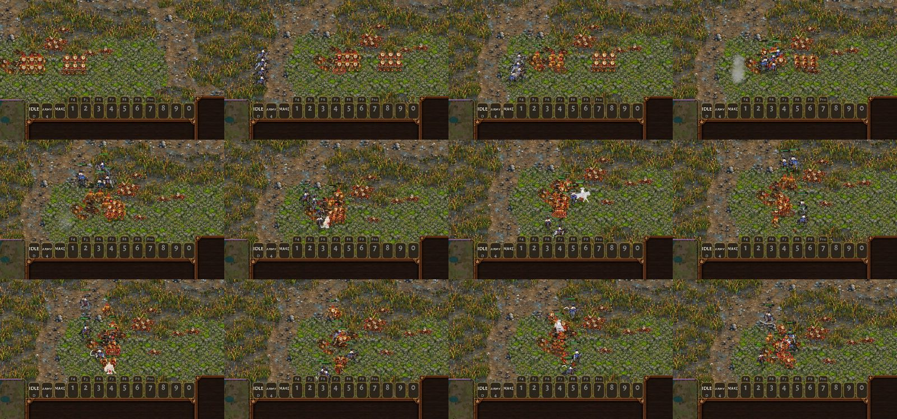
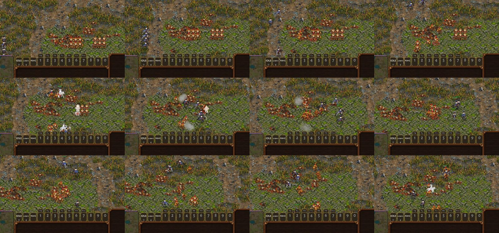

# crown-coach-cavalry: the Crown computer's riders hit and run

The owner (2026-11-15 00:53): "You never let your cavalry stay in the fight like that, you always keep microing it so
you can use charge as much as possible. You never leave your cavalry in the fighting, they are always moving, abusing its
mobility even without charge researched, but with it researched then it's much more useful, the microing of in and out."

Rules followed: docs/design_principles.md 1 (fair: the computer does with its riders what a player does, from what it
sees; no unit, research or economy number changed) and 4 (out-micro as a way to win). AI only. Tested against main as it
is (Horseman 140 health and 115 gold, Raptor 36 health): the balance job that may change the Horseman to 100/100 and the
Raptor to 38 health was not on main when this ran.

**Switch:** `-- cavmicro:off` plays the riders as before. Normal difficulty and up; Easy is untouched.

## In short

- The Horseman already fought on the move (scripts/ride_by.gd, 0.14.x: a pass, a blow in passing, a loop round the
  target). What the computer did badly was what it rode at and how long it stayed: an attack-move into the enemy's mass
  looped round whatever was nearest, a Brute, a Clock Soldier's shield, a bayonet line, blow after blow inside the
  enemy's answer, and the Cavalry Charge came only once (the first blow after a gallop; a run counts again only after 5 s
  without a blow, `Defs.RIDE_BY["calm"]`).
- Now (`scripts/ai_cav_micro.gd`, class `AICavMicro`, ticked by the Crown computer every 0.1 s): each rider in a fight
  picks its prey, rides in (pistol first, then the sabre in passing), rides out before the answer lands, and comes in again
  from where it is: another angle. With the charge drilled it gallops round out of reach until the next blow will be a
  charge, then comes in.
- On a set test bed (4 Horsemen against five enemy groups, three times each, `tools/test_cav_micro.gd`) the micro kills
  **2.50** gold of enemy per point of rider health lost (**1.95** before), loses **5** riders of 120 (**32** before) and,
  with the charge, strikes **118** charged blows (**60** before: one per rider per fight).
- In whole games (computer against computer, 15 minutes) the riders stand in a melee far less (Brood: 9-10 s a game set
  against 55; mirror: 6 against 34) and, with the charge, lose far fewer riders (Brood 25 against 44, mirror 35 against 66)
  for about the same damage per rider lost against the Brood (229-258 against 271), more in the mirror (289 against 174)
  and against the Clockwork (183-242 against 154). They also deal less damage in all: a rider that waits for its charge
  strikes less often (see Claude's choice 2). Results (wins) did not move: the Crown computer still loses to the Brood.

## What it does (`AICavMicro`)

Which riders: every Crown Horseman (and Cuirassier: the same kind with Armour) in the saddle, on an attack-move, an attack,
or standing on guard, with an enemy within 300 px. Never one on a plain move (someone sent it somewhere: a raid riding
home, the wave regrouping), on HOLD, on an errand (the rider screen, the picket, the map loop's scouts, a rearm: `AI._on_errand`)
or in a siege. Someone else's plain move or HOLD takes a rider back at once; someone else's attack-move or attack (the
wave's think re-sends them every few seconds) is overruled. When no enemy is within 440 px for 2 s, the rider gets its old
order back.

1. **The prey** (`_pick`, within 380 px and 520 px of where the fight was taken): what a pass is worth (`_worth`):
   workers 3, guns and gunners (a reach of 100+: Musketeers, Spitters, cannons, Arc Throwers) 2.4, the ones the sabre has a
   bonus on (cannons, Spitters, Arc Throwers) 3 x the bonus, other fighters 1; times up to 2.2 for the hurt. Nothing for
   armoured or massive units (Brutes, Bulwarks, the Mother) unless under 30% health; shields (Clock Soldiers, Wind-up
   Soldiers, Bulwarks) and pikes x0.35-0.4. Less for the guard round it (`_danger`): the enemy's blades within 115 px,
   Brutes and armour x2, shields x1.5, pikes x2, a bayonet x1.5, a gun 0.3 (it shoots wherever the rider is), light
   biters less (a Raptor dies in two blows). A prey with more guard than 4.5 + its worth is left alone. Under fire (an
   enemy gun has the rider in reach) the guns that shoot it come first and the nearest of them; the hands behind them wait.
2. **In**: an attack order on the prey (RideBy's pass and loop; the pistol fires first by itself).
3. **Out**: once it has struck, if an enemy blade is within 130 px it rides 220 px away from the enemy's fighters for 1.2 s
   (2.2 s with the charge). Only guns about: it keeps at its prey, loop after loop (riding out under muskets only gives
   them their volley). A Raptor or another fast biter on it under fire: it fights on (riding out does not shake it off).
4. **Round**: with the Cavalry Charge drilled and no gun on it, it gallops round the fight 190-300 px out until 5 s have
   passed since its last blow and the run will be full by the time it gets there (`Unit.run_t`, `Defs.CHARGE["run"]` 2 s),
   then picks its prey again, from wherever it is round the circle, and goes in: a charged blow (double, a throw back and a
   stun). A charged pass may go deeper into a guard (+2). Exceptions: a prey one plain blow kills is struck now; after 14 s
   round it goes in anyway. No prey worth a pass: it rounds out of reach (straight away from biters on its heels, out of a
   gun's reach) and waits.
5. **Hurt**: under 45% health a rider only rides at prey with next to no guard and no enemy gun reaching it; under 15% it
   rides home and is left alone 40 s. (A Horseman does not heal; the first version sent riders home at 35%, and the waves
   only sent them out again, unled: see the batches below.)

## Measures

`Game.stats` has four new counts for every side (written by `Unit._strike`, read by the tools): `cav_blows` (plain sabre
blows of Horsemen), `cav_charged` (charged ones), `cav_dmg` (their sabre damage), `cav_pistol` (pistol shots fired from the
saddle).

### The test bed (`tools/test_cav_micro.gd`)

4 Horsemen on an attack-move onto a group on open ground (Hollowfen), 45 s, each case three times (summed), micro off and
on, without and with the Cavalry Charge. The final version:

| case | charge | micro | killed (value, summed) | riders lost | health left (mean) | blows plain / charged | stood (s) |
|---|---|---|---|---|---|---|---|
| 16 Raptors | no | off | 2400 | 0 of 12 | 60% | 87 / 0 | 0.5 |
| 16 Raptors | no | on | 2350 | 0 of 12 | 74% | 85 / 0 | 0.8 |
| 16 Raptors | yes | off | 2400 | 0 of 12 | 61% | 68 / 12 | 0.2 |
| 16 Raptors | yes | on | 2400 | 0 of 12 | 79% | 51 / 23 | 0.0 |
| 8 Raptors, 5 Spitters | no | off | 2550 | 0 of 12 | 63% | 82 / 0 | 0.0 |
| 8 Raptors, 5 Spitters | no | on | 2400 | 0 of 12 | 53% | 78 / 0 | 0.8 |
| 8 Raptors, 5 Spitters | yes | off | 2550 | 0 of 12 | 69% | 63 / 12 | 0.0 |
| 8 Raptors, 5 Spitters | yes | on | 2550 | 0 of 12 | 56% | 57 / 18 | 0.8 |
| 3 Brutes, 5 Spitters | no | off | 1770 | 11 of 12 | 1% | 132 / 0 | 0.0 |
| 3 Brutes, 5 Spitters | no | on | 1350 | 0 of 12 | 45% | 45 / 0 | 0.8 |
| 3 Brutes, 5 Spitters | yes | off | 1830 | 11 of 12 | 2% | 121 / 12 | 0.0 |
| 3 Brutes, 5 Spitters | yes | on | 1500 | 5 of 12 | 8% | 58 / 21 | 2.2 |
| 6 Clock Soldiers, 6 Winders | no | off | 770 | 3 of 12 | 28% | 376 / 0 | 1.8 |
| 6 Clock Soldiers, 6 Winders | no | on | 1150 | 0 of 12 | 61% | 84 / 0 | 0.5 |
| 6 Clock Soldiers, 6 Winders | yes | off | 1040 | 4 of 12 | 35% | 343 / 12 | 0.5 |
| 6 Clock Soldiers, 6 Winders | yes | on | 1590 | 0 of 12 | 69% | 65 / 36 | 0.0 |
| 6 Musketeers, 5 Labourers | no | off | 1830 | 1 of 12 | 46% | 104 / 0 | 0.2 |
| 6 Musketeers, 5 Labourers | no | on | 1830 | 0 of 12 | 43% | 105 / 0 | 0.0 |
| 6 Musketeers, 5 Labourers | yes | off | 1830 | 2 of 12 | 56% | 81 / 12 | 0.0 |
| 6 Musketeers, 5 Labourers | yes | on | 1830 | 0 of 12 | 60% | 68 / 20 | 0.0 |

The checks pass: value killed per point of rider health lost 2.50 (before 1.95), charged blows 118 (60), riders lost 5
(32). Where it is worse: Raptors before Spitters (the riders go for the Spitters past the Raptors; the old way killed
the near Raptors first and was quicker). The fights are noisy: the same case played again moves by 10-20 points of health.

Filmed (`film:DIR` under xvfb-run; a picture every 0.6 s, 12 of them here), 6 Clock Soldiers before 6 Winders, with the
charge: before, the four ride into the shields together and loop there; after, they split, come round the shields' ends
from above and below at the Winders, and the white dust is a charged blow throwing a Winder back.

### Whole games (`tools/study_cav_micro.gd`)

Hard computers, OPTIMAL plans, 15:00 (or the end), Greenhold, Dune Sea, Kestrel Rise, seeds 1 and 2; "stood" = seconds a
Horseman stood still (under 30% of its speed) with an enemy blade at sabre's reach, summed over the games; damage is the
sabre's.

**Batch 1, as the games play (the first version of the micro: hurt riders sent home at 35%).** The computer drilled the
Cavalry Charge in 13 of 36 sides' games, never before 10:00, so these are mostly riders without it.

| matchup | micro | games | riders made | lost | blows plain / charged | sabre dmg | dmg per rider lost | stood (s) | Crown W-L |
|---|---|---|---|---|---|---|---|---|---|
| v Brood | off | 6 | 53 | 42 | 448 / 0 | 8387 | 200 | 91 | 0-4 |
| v Brood | on | 6 | 44 | 44 | 420 / 0 | 8228 | 187 | 25 | 0-4 |
| v Clockwork | off | 6 | 54 | 40 | 318 / 21 | 6575 | 164 | 51 | 0-1 |
| v Clockwork | on | 6 | 57 | 45 | 313 / 14 | 6271 | 139 | 47 | 0-1 |
| mirror (both sides) | off | 3 | 51 | 19 | 286 / 31 | 6392 | 336 | 4 | - |
| mirror (both sides) | on | 3 | 67 | 28 | 310 / 5 | 6012 | 215 | 10 | - |

Without the charge, the first version did no better than before: the same damage, the same losses; its riders sent home
hurt were sent out again by the next wave, unled. That is why hurt riders now stay in the micro, careful (rule 5).

**Batch 2, the charge given at 4:00** (`charge:240`, a study tool: to measure the charge's use, as the computer seldom
drills it in time). Micro on = the version with careful hurt riders; batch 3 = the final version (a killing blow first,
deeper charged passes), on only.

| matchup | micro | games | riders made | lost | blows plain / charged | charged share | sabre dmg | dmg per rider lost | stood (s) | Crown W-L |
|---|---|---|---|---|---|---|---|---|---|---|
| v Brood | off | 4 | 45 | 44 | 327 / 151 | 32% | 11907 | 271 | 55 | 0-2 |
| v Brood | on | 4 | 38 | 25 | 143 / 101 | 41% | 6460 | 258 | 9 | 0-2 |
| v Brood (final) | on | 4 | 35 | 31 | 155 / 108 | 41% | 7092 | 229 | 10 | 0-3 |
| v Clockwork | off | 4 | 57 | 45 | 266 / 55 | 17% | 6949 | 154 | 55 | 0-0 |
| v Clockwork | on | 4 | 18 | 15 | 107 / 22 | 17% | 2751 | 183 | 43 | 0-1 |
| v Clockwork (final) | on | 4 | 35 | 22 | 195 / 46 | 19% | 5329 | 242 | 26 | 0-1 |
| mirror (both sides) | off | 4 | 100 | 66 | 368 / 126 | 26% | 11516 | 174 | 34 | - |
| mirror (both sides) | on | 4 | 87 | 35 | 289 / 126 | 30% | 10117 | 289 | 6 | - |

Read: the riders now keep out of the melee (stood 9-10 s against 55 against the Brood, 6 against 34 in the mirror) and
live (25-31 lost against 44; 35 against 66), and a bigger share of their blows are charges. Against the Brood the damage
for each rider lost is about the same (229-258 against 271) and the total damage is lower: in and out against Raptor packs
(fast, many, cheap) trades about even with the old loop; the gain there is riders kept alive. Against the Clockwork and in
the mirror each rider lost is worth more damage than before (183-242 against 154; 289 against 174). The plans and the
riders trained differ a lot from game to game (v Clockwork: 18 to 57 riders in four games), so these are signs, not
proof; no result changed.

**Batch 4, the final version (after the two fixes below), charge at 4:00, the same seeds as four of batch 2's games:**
v Brood (Greenhold 1, Dune Sea 1): 10 riders made, 10 lost, 52 plain / 43 charged blows, 2700 damage (270 a rider lost),
0 s stood (batch 2 off on those two games: 24 made and lost, 201 / 74, 6647 damage, 277 a rider lost, 44 s stood); v
Clockwork (Greenhold 1): 21 made, 14 lost, 86 / 23, 2440 (174), 10 s (off: 12, 10, 71 / 13, 1777 (178), 16 s); mirror
(Greenhold 1, side A): 12 made, 3 lost, 57 / 13, 1594 (531), 0.5 s (off: 10, 8, 50 / 17, 1531 (191), 4 s). On Dune Sea 1
the Brood won with the micro on (both versions) where the game without it was still going at 15:00; on the other three
the result was the same.

## Claude's choices (for the owner)

1. **Whose riders.** Only riders on a fighting order (attack-move, attack, on guard). A plain move or HOLD from any other
   part of the computer wins at once (raids riding home, the wave regrouping, the screen, the scouts, a rearm). The
   Horseman rush, the raids (AIHarass, the Dragoon raids' Horsemen) and the line's waves all get the micro when they fight,
   through their attack and attack-move orders; nothing in them was changed.
2. **The charge and the damage.** By the numbers a charged blow every ~7 s (36 damage, a throw and a stun) is less damage
   than a plain blow every 1.1 s (18 each). The owner's order is followed (out, round, back in charged, every time), with
   two exceptions: under fire from guns (Musketeers, Spitters) it does not wait, riding round under fire only feeds them,
   it keeps at the guns; and a prey one plain blow kills is struck at once. This is why the riders deal less in all and
   live longer.
3. **What is never a prey of choice:** armour and mass over 30% health (Brutes, Bulwarks, the Mother), shields (Clock and
   Wind-up Soldiers) and pikes, and anything with more guard round it than a pass is worth.
4. **Hurt riders** (they do not heal): careful under 45%, home only under 15%.
5. **Dragoons are not in it.** A mounted Dragoon cannot strike; it dismounts to fire and remounts, and the Dragoon raid
   (scripts/ai_dragoon_raid.gd) has its own in and out for that. Changing it would cross that job.
6. **The charge comes late.** The computer drills the Cavalry Charge (60 gold) from 2 Horsemen, but only with an
   Armoury: in batch 1 it had it in 13 of 36 games, never before 10:00. Proposal (a build-order question, so for the
   economy and army jobs): an Armoury and the charge soon after the Horse Breeder in the plans that ride (the Horseman
   rush, the Dragoon raids, the screen).
7. **The test bed is part of it:** `tools/test_cav_micro.gd` (its checks: more value killed per health lost, more charged
   blows with the charge, fewer riders lost).

## Two fixes after the batches

The Crown AI tests found two things the batches above ran without (both in the final version):
- **Someone else's move wins.** A raid riding home sends a plain move; the micro's own out and round orders are plain
  moves too, and it took the raid's for its own and rode on (test_ai_harass `[raid]`: the riders did not ride home from a
  Tyrant Sire). Now a move to another spot than the micro's is someone else's, and the rider is theirs.
- **No fight over a rooted turtle.** A raid near a rooted Mound Turtle (no prey worth a pass in reach, the grubs farther
  off) was taken by the micro and circled the turtle for good (test_ai_harass `[cuirassier]`, `[raid]`: no grub hurt).
  Now a rider is taken only for a prey worth a pass or a fighter that can come at it (rooted and static ones do not
  count), and a rider rounding 3 s with neither is let go to the computer's own orders.

## Tests

The Crown AI tests (`test_ai_*`, `test_crown_*`, `test_cinder_crown`; 40 files) and `tools/test_cav_micro.gd`, on the final
version: all pass but these, and each of them fails with `cavmicro:off` too (the micro never runs):
- `test_ai_rush_followup`: 14-15 checks, the same with the micro off (known, CLAUDE.md: test_ai_rush / _rush_followup).
- `test_crown_dragoon_raid` `[plan]`: the same with it off (known).
- `test_cinder_crown` `[hall]` (389 s, wants 330) and `[labs]` (21 of 23): `[hall]` fails with it off too (339 s); both
  known flaky (CLAUDE.md).
- `test_ai_brood` (stage 3 timing) and `test_ai_scout_sentry`: failed once in the full run, passed alone on the final
  version, and failed once with the micro off (known flaky).

`test_ai_harass` failed with the first version (see the fixes above) and passes now; `test_crown_mirror` and `test_ai_rush`
pass. (The test runs end with an engine abort, exit code 134, after their last line, on main too: the verdict is the
printed PASS / FAIL lines.)
