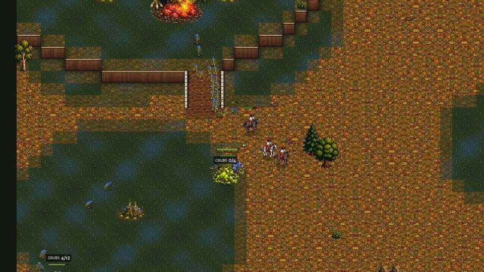
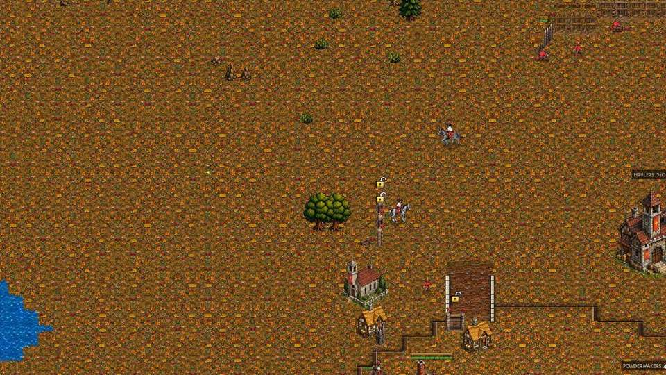
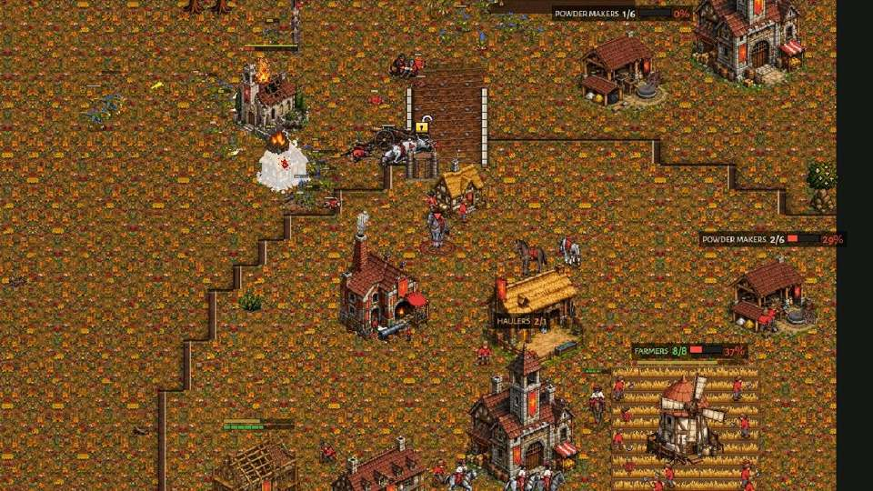
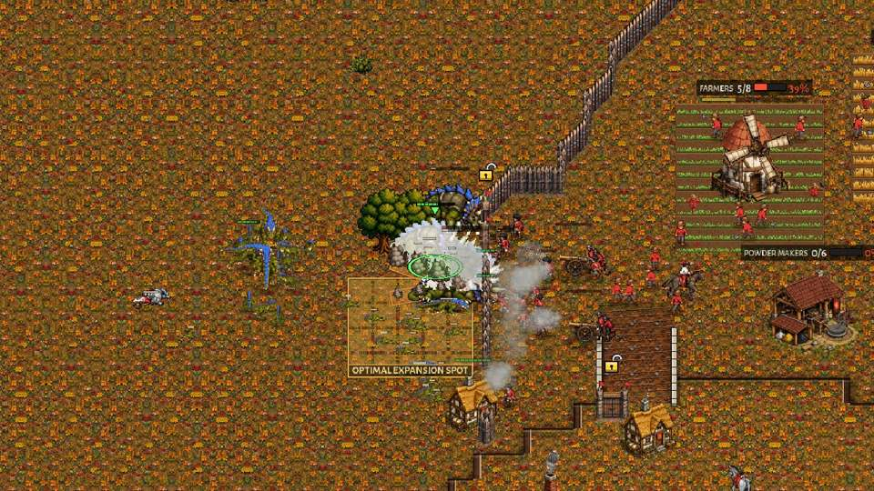
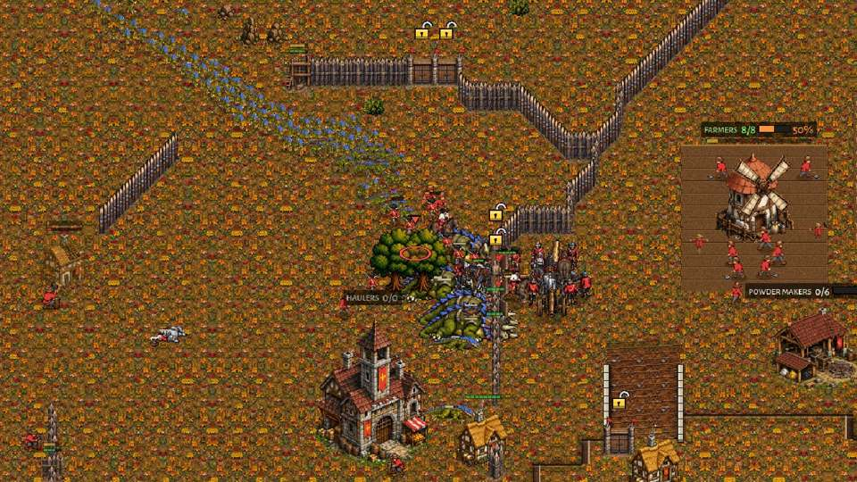

# crown-coach-v-brood: the Crown computer's game plan against the Brood, coached (0.38.2)

The owner (2026-11-15 00:28, after a Hard OPTIMAL v Hard OPTIMAL game he watched, Crown v Clockwork on Hollowfen): "Terrible
game from crown ... that is why it can never win, the ai is very bad. You need to do multiple coaching jobs on crown." This
job is the Crown against the Brood (0-11-27 in the last win-rate study, docs/winrate_2026_11_12.md; earlier coaching:
docs/crown_v_brood_coach.md). AI only: no unit, building, economy or Brood number changed. Everything is gated to the Crown
computer facing the Brood computer (Normal and up) and lives in `scripts/ai_crown_v_brood.gd` (AICrownVBrood), with thin
hooks in `scripts/ai_crown.gd`. **`-- cvb:off` plays the matchup as before this job.** Four other Crown coaching jobs run
at the same time (balloon harass, defence, army size, economy); this one stays out of their code.

Design rules followed (docs/design_principles.md): 2 (the defender's advantage needs defenders: a palisade with nobody
behind it holds a Raptor for 15 s) and 4 (every choice has an opportunity cost: a Church and a 30-piece palisade while the
Barracks stands idle is the wrong one).

**In short.** The films showed one mistake above the others: after the Horseman rush the Crown put its gold into buildings
and walls and let its Barracks stand idle for two to three minutes, counting six Horsemen out raiding as its home army,
until the Brood's first big wave (6:30-8:00) walked into one Musketeer and a gun. Now, against the Brood, the home LINE
(Musketeers and guns, not the riders) keeps up with a floor by the clock, its gold comes before the palisade, the Farms and
the milestones, its powder is ground, and no Church goes up before it. Measured on the 16 Crown v Brood OPTIMAL games (8
maps, 2 seeds, sides swapped): W-D-L **0-2-14 -> 0-5-11**, the Crown's army against the Brood's at 10:00 **0.40 -> 0.42**
and at 12:00 **0.16 -> 0.27**; the cost is labour: income at 10:00 0.68 -> 0.59 of the Brood's, labourers at 8:00 0.60 ->
0.52. **It still wins none.** The W-D-L change is within the noise of 16 games (a won-or-led count moves about +-3 between
two runs of the same games); the army at 12:00 is the clearest gain. Three more ideas were built, measured and NOT kept as
the default (the riders' rush replaced by the Economy race, the counter after a held wave, the line's gold kept from the
labourers too): section 4.

## 1. How the coaching ran

- **Measuring**: `python3 tools/study/crown_coach_v_brood.py run OUT --data DATA --only measure [--extra switch,...]`
  (Hard Crown OPTIMAL v Hard Brood OPTIMAL to 15:00, `tools/qa_match.gd`; the 16 games of docs/crown_ai_v2.md, the same
  ones the earlier coaching used) and `... report DATA [DATA2 ...] [--games]`. Each game keeps its AI STORY (`story.txt`) and,
  from round 3 on, the Crown's own match-log lines (`crlog.txt`). "Won or led" = won, or a draw at 15:00 with income + 2 x
  army 10% ahead; ratios are the Crown's sums over the Brood's (army at 4, 6, 8, 10, 12 minutes; income earned at 5, 8, 10).
  D+ / D- / D= in the per-game lists: a draw led, trailed, even.
- **Filming**: `tools/shot_ai_match.gd` with `coach:1` (a status line for each side every 15 s, the Crown's army every 30 s,
  the riders every 10 s, the fights), Highmoor seed 1103 (the Brood P1, the Crown P2), before and after.
- **The "before"** is main at 90d51b59 (0.38.1), run in a worktree beside this branch. Data: `docs/crown-coach-v-brood/data/`
  (`before`, `line_v1` = round 1's line, `econrace_noline`, `econrace_widekeep`, `final_with_counter`, `after` = this branch's
  default). Pictures: `docs/shots/crown-coach-v-brood/`.
- The games do not repeat: the same map and seed part after a few minutes, so a replay of a seed is the same start, and a
  batch of 16 is the unit of comparison. Each batch is ~45 minutes on this machine (2 games at a time).

## 2. The coach's notes on the "before" games

### Highmoor 1103, filmed (lost at 10:50)

| time | what happened |
|---|---|
| 0:00 | OPTIMAL leans to the Horseman rush before it scouts ("Horsemen are good against the Brood's grubs"). |
| 1:47 | The scout reads GREEDY (the Brood's usual Mound Turtle on new ground): it keeps the rush. The Brood sees the Horse Breeder and makes Raptors. |
| 4:05-5:24 | Three, then six Horsemen ride round the Brood's Rootmaws; the Brood's warriors guard the grubs, no chase (`b0`). 150 killed. 5:24: rush FAILED, "no headway in 90 s", handed to the Economy plan. |
| 5:05-7:21 | **The Barracks stands idle** (busy 0/1 in every status line, bank 0-20) while the gold goes, think after think, to the natural's palisade (30 pieces), a Foundry, a **Church** (5:41), two Farms, a second Powder Mill and Cottages. The army it weighs is 690: **six Horsemen, out raiding** (`b1`). Its own words: "milestone Barracks waits: the army is far behind the enemy's (730 against the 475 it reckons)" while "army_due false, behind false". |
| 7:21 | The first Musketeer. |
| 7:47-8:20 | The Brood's wave (730) at the natural's palisade: one Musketeer and one Field Cannon behind it (`b2`). Farm, Church, Cottage lost; the Raptors in the main by 9:07. |
| 9:35-10:50 | 0 labourers, both halls razed. |

### The batch (16 games, 0-2-14)

- **The army flat while the Brood climbs**: the Crown's army was 575-695 at 6:00 in 14 of 16 games (the rush's riders), the
  Brood's 1,060 on average at 8:00; the army ratio fell from 1.13 at 4:00 to 0.67 at 8:00 and 0.16 at 12:00.
- **Even or ahead at 10:00 and still lost** (Highmoor 1103: 2,120 against 1,495; Hollowfen 1151: 2,125 against 1,525): the
  Brood's wave at its supply cap (96 supply at 10:46) broke a line of 19 behind the palisade in nine seconds, after a minute
  and a half in which the Crown "holds its wave back: the enemy army it knows is bigger" (its reckoning, `AICrown.BROOD_TABLE`,
  is 3,800 at 10:00 and it wants 1.5 times that).
- **The powder stall** (seen in a check game of this branch's first cut, Hollowfen 1151, the line's floor already on): the
  Powder Mill stood from 4:36 and the bank held 0-9 powder until 6:00; the Mill's crew grows only "while something trains with the powder", and a Barracks idle for want
  of powder is no such thing: neither grows (`AICrown._mill_feedback`).
- **The Church**: every rush game put up a Church for 150 gold at about 4:00-4:30 (the shared `AI._build_up` puts one up
  after 3:40 on Hard while the plan's milestones are not yet in charge, which in the rush's long build order is until ~4:50).

## 3. What changed (the default)

`scripts/ai_crown_v_brood.gd`, part 1 and part 4 (hooks in `scripts/ai_crown.gd`: `vb()`, `vb_line_short()`, `_vb_keep()`).

| # | change | where | switch | the mistake it answers |
|---|---|---|---|---|
| 1 | **THE LINE BEFORE THE BUILDINGS.** From 4:00 the home line (Musketeers, Field Cannons, Mortars: not the riders) keeps up with a floor by the clock, `LINE_TABLE`: 300 at 5:00, 900 at 6:30, 1,200 at 7:30, 1,900 at 10:00, 2,600 at 12:00, never more than 45 gold a labourer (600 at least). While it is short: two Musketeers' gold (and a Field Cannon's when a Foundry with a horse stands idle and there are more than 4 Musketeers a gun) is kept from the Farms (`_econ_build`), the milestones (`_build_up`) and the natural's palisade (`brood_wall_keep`); the halls train a labourer only when every Barracks is busy (`_army_due`); the milestones are held as when the army lags (`brood_spend_army`); no more riders (`_riders_wait`), and the rush's riders-only Barracks trains Musketeers (`_rush_horse_only`). Not while the supply is full. | `AICrownVBrood.line_short/line_keep` | `cvbline:off` | Highmoor 1103, 5:05-7:21 |
| 2 | **THE LINE'S POWDER.** While the line is short the Mill's crew grows (an idle Barracks for want of powder counts as wanting it), and in the opening the Mill has at least 4 hands. | `AICrown._mill_feedback`, `_mill_cap_plan` | `cvbline:off` | the powder stall |
| 3 | **NO CHURCH BEFORE THE LINE**: against the Brood no Church before 10:00 or while the line is short (the plans' own milestones put it up at 34-40 labourers on two halls). | `AICrown._construct`, `AICrownVBrood.church_waits` | `cvbline:off` | the Church at 4:00-5:55 |
| 4 | **THE ECONOMY RACE GRINDS POWDER FIRST** (only when OPTIMAL picks the Economy race against the Brood, or a study plays it): the Barracks at 8 and the Powder Mill at 9 labourers before the second hall at 11, so its first Musketeers can come by 4:30. | `PLANS["economy"]["bo_brood_cvb"]` | `cvbopen:off` | the Economy race's army of 0 until 6:00 (section 4) |

The AI STORY has rows for the new log lines (`scripts/ai_story_lines.gd`, pt and es in `tools/i18n/49_spectator.txt`): the
line before the buildings, and the counter's two lines (study switch).

### The same seed after (Highmoor 1103, filmed on this branch: alive at 12:00)

| time | what happened |
|---|---|
| 0:00-5:00 | The same lean, read and rush; the riders out at ~4:05. From 4:00 the line is "short" and says so ("the line comes before more buildings: 60 of Musketeers and guns against the 309 it wants by now"). The first Musketeer at ~4:50 (7:21 before), no Church. |
| 6:05-7:05 | **The new fault the film shows**: halls 0/2, Barracks 0/1, Foundry 0/1, all idle, the bank at 10-50 gold with 84-121 powder; 11-12 of the 24 labourers on "build" orders laying the natural's palisade, the Farms manned 8 of 24, so **the gold earned stood still for a minute** (4,180 at 6:05, 4,560 at 7:05: one harvest). The line had 3 Musketeers. |
| 8:19-9:19 | The Brood's wave (57 supply, Brutes and Challengers) at the natural: the line (13 Musketeers, 2 guns) holds behind the palisade and the guns fire over it (`a1`): 950 killed for 115 by 9:05, 1,900 for 275 by 10:05. Army 2,080 at 10:05 (the "before" film had lost both halls by then). |
| 10:18-11:05 | The Brood's next wave at its cap (101 supply, 78 Raptors) comes through a gap at the end of the palisade where the army stands packed, not in a line (`a2`): 1,760 lost in a minute. Alive at 12:00 with a third hall, 890 of army. |

## 4. Built, measured, NOT kept as the default (the switches stay for a study)

| idea | switch | batch | W-D-L | army 10:00 / 12:00 | income 10:00 | labourers 8:00 | why not |
|---|---|---|---|---|---|---|---|
| before (main 0.38.1) | - | `before` | 0-2-14 | 0.40 / 0.16 | 0.68 | 0.60 | |
| round 1: the line (part 1 only, an earlier cut) | - | `line_v1` | 0-6-10 | 0.53 / 0.51 | 0.63 | 0.54 | (the start of the default) |
| **after: this branch's default** | - | `after` | **0-5-11** | **0.42 / 0.27** | 0.59 | 0.52 | |
| + the counter after a held wave + the far-ground target | `cvbcounter:on,cvbtarget:on` | `final_with_counter` | 0-4-12 | 0.36 / 0.34 | 0.65 | 0.55 | no gain; see below |
| the Economy race instead of the rush (an earlier cut with the line) | `truegreed:on,leanfree:on` | `econrace_noline` | 0-5-11 | 0.54 / 0.45 | **0.81** | **0.83** | the army 0 at 4:00 and 0.22 at 6:00; the Brood's army at 8:00 1,964 on average against 1,214 with the riders out |
| the Economy race + the line kept from the labourers too | `truegreed:on,leanfree:on,cvbkeep:wide` | `econrace_widekeep` | 0-2-14 | 0.16 / 0.05 | 0.63 | 0.68 | the income fell, the army was no bigger |

- **The riders stay (the owner's rule, v a greedy Brood the Horse Breeder).** The Economy race earned far more (0.81 of the
  Brood's at 10:00 against 0.59-0.68, the labourers 0.83 of the Brood's at 8:00) but **the Brood's own army at 8:00 was 60%
  bigger when no riders came** (1,964 on average, 9 of 16 Brood computers on the Spitter timing, against 1,139-1,407 in the
  rush batches): three to six Horsemen at its Rootmaws keep 15-20 of its warriors standing guard over the grubs ("guards its
  grubs where the riders are with 16 warriors against 3 riders, no chase"), and the grubs stop working while they are there.
  The riders' worth is in the Brood's economy, as econ-coach-crown found.
- **The line kept from the labourers** (`cvbkeep:wide`: the line's gold kept from everything the think stages 0 and 1 spend,
  the opening's steps too, and the opening's army cap passed by): the halls stood idle, income at 10:00 fell from 0.81 to 0.63
  of the Brood's, and the army was no bigger (0.16 at 10:00). Measured with the Economy race and the earlier Mill, so it is
  not a clean A/B, but the direction is clear.
- **THE COUNTER AFTER A HELD WAVE** (`cvbcounter:on`; part 3 of the file): from 6:00, with 1,200 of army or more, the wave
  goes at once when the Crown killed at least 0.45 of its ready army's value in the last 75 s, or its army is 1.4 times the
  Brood army seen in the last two minutes. **THE WAVE GOES FOR THE BROOD'S FAR GROUND** (`cvbtarget:on`; part 2): the wave's
  target is the nearest Rootmaw seen rooted 14+ tiles from the Mother instead of the Brood's start (a Brood has no hall: the
  shared wave target fell back to the Mother on her nest). It went out in 4 of 16 games. Greenhold 1100 (`final_with_counter`):
  out at 11:11 with 2,155 of army after "2,750 killed in 75 s", the Brood at 570 then 300; it took 94 s to reach the far ground
  (the line closed up twice and formed a rank of 22 for a guard of 150 on the way), killed 4 of 7 Rootmaws by 13:00, and the
  Brood rebuilt **from 300 to 4,030 of army in two minutes** and came for the halls the wave had left bare: 44 labourers at
  13:00, 8 at 14:00. With both on: 0-4-12 against 0-5-11 without; no gain within the noise, so off.

## 5. Tests

Run on this branch (`godot --headless --fixed-fps 30 --path . --script res://tools/<test>.gd`, every tools/test_ai_*,
test_crown_*, test_cinder_crown*): see section 7 for the list; the ones that failed were run again on main (0.38.1) to
tell this job's from the old ones.

TESTS_RESULT

## 6. What is still wrong

1. **The Brood out-grows the Crown, and this job made the Crown's labour a little worse.** Labourers at 8:00 0.52 of the
   Brood's (0.60 before): the line's gold comes partly from the halls (they wait while a Barracks is idle). The Brood at 8:00
   has 45-54 grubs and four grounds against the Crown's 24-36 labourers and two halls (Highmoor 1103: income 21,598 against
   10,640 by 15:00). The economy job's area; the proposals of docs/crown_v_brood_coach.md section 8 (a Cottage of 10 supply
   or the hall training two labourers at once) are still the owner's to decide.
2. **The natural's palisade takes the labourers off the Farms** (the "after" film, 6:05-7:05: 11-12 of 24 labourers laying
   it, Farms 8/24, no gold for a minute, every building idle). The economy and defence jobs' area (AIExpandWall's crew);
   the line's gold is kept from the palisade's price, not from its builders' time.
3. **The line is still short at the first big wave.** Even with the floor, the home line was 180-470 at 6:00-7:00 in the
   check games (the floor wants 900-1,100): one Barracks and the powder hold it (one Musketeer every 15 s at most, 10 powder
   each), and the second Barracks waits for the first to be busy. The Brood's waves at 6:24-7:07 (23-34 supply) still take
   the natural in about half the games.
4. **A big Brood wave breaks a line of 15-20 behind the palisade in seconds** (the "before" Hollowfen 1151: 19 to 2 in 9 s;
   still seen after: `a2`, the army packed at a gap at the palisade's end). The defence job's area (the line's spacing, the
   guns' canister, the walls).
5. **When it is ahead the Crown does not finish.** In the "after" batch the Crown led the armies at 10:00 in 3 of 16 games
   (Highmoor 1103 2,350 against 1,175, Greenhold 1100 1,815 against 1,000, Red Coast 1161 1,235 against 575) and won none: the wave waits for 1.5 times a reckoning of 3,800 at 10:00 (`AICrown.BROOD_TABLE`, made to stop blind attacks),
   and the counter (section 4) was too slow and left home bare. A counter that works would be: a strike of the line's
   fast part at the nearest far Rootmaws without stopping to form for a token guard, a home guard of a third left behind at
   the gate, and the way home on a timer (60-90 s) or at the first sight of the Brood's next wave.

## 7. Claude's choices for the owner to confirm

1. **The home line's floor by the clock** (`LINE_TABLE`: 300 at 5:00, 900 at 6:30, 1,900 at 10:00, 2,600 at 12:00, at most
   45 gold a labourer), counting Musketeers and guns, not the riders. The riders are the Brood's problem; the line is the
   Crown's defence.
2. **The line's gold before the Farms, the palisade and the milestones, but not before the labourers' gold** (the wide keep
   measured worse); the halls still wait while a Barracks is idle, as `_army_due` did before.
3. **No Church before 10:00 against the Brood.**
4. **The rush stays the answer to the Brood's usual opening** (the owner's rule): measured against the Economy race, it holds
   the Brood's army down by about a third at 8:00. The Economy race's opening against the Brood now grinds powder before its
   second hall (used when the read is too late for the riders, or by a study).
5. **The counter after a held wave and the far-ground target are off** (study switches): built and measured, no gain yet;
   the next try is in section 6 item 4.
