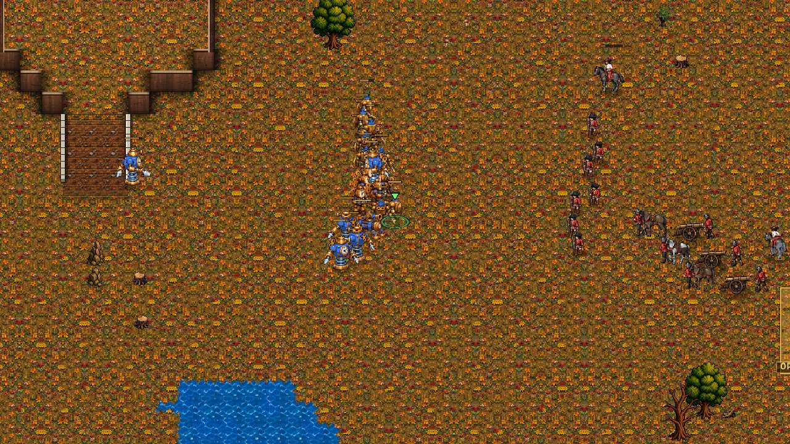
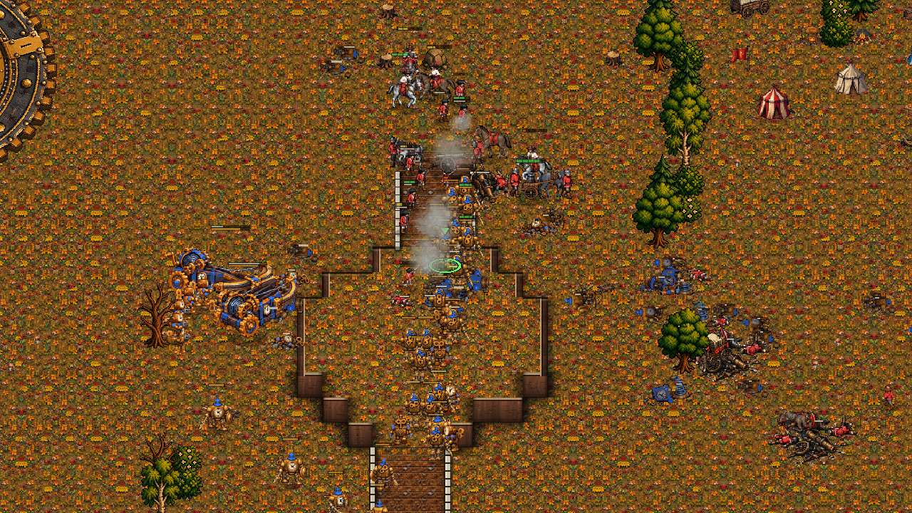

# The Crown's guns and line coached (crown-guns-coach, 2026-11-17)

The owner (2026-11-15 22:20, again 2026-11-16 23:25 "start all coaching jobs needed"): *"focus on wall making and microing
the army, screening with Horsemen, setting cannon before the engagement is very important, it doesn't help if the enemy
is on top of you and the cannon is still unlimbering, that is why Horseman screening is so important".*

A coaching job on the Crown computer's FIGHTING only (scripts/ai_crown_guns.gd `AICrownGuns`, hooks in
scripts/ai_crown_line.gd, ai_crown_screen.gd, ai_crown_hold.gd, ai_crown_mirror.gd, ai.gd): **no unit, price or rule number
changed**, every change behind a switch (`gunscoach:off` all of it; each rule its own, below). Branch crown-guns-coach from
main 0.38.38.

__SUMMARY__

## What was wrong (with pictures)

The last measurement (docs/crown_coach_measure_2.md) found the guns set early in only 13-16 of 38 games, screen sightings
0.4 a game, and in its film crcw_highmoor_1104 the guns limbered behind the formed line and a wave climbing the
Clockwork's ramp as a column. Watching that film again, tracing the guns order by order (tools/bench_crown_guns.gd
`trace:1`, a stack print on every order a set gun got) and counting every fight (the new count, below) gave these causes:

1. **The wave's shared order loop took the guns back from the line.** The line (AICrownLine) hands its men back to the
   army's shared loop whenever it is not forming: in a fight, and in the coach's held line ("await", rule 6 of
   AICrownCoach). That loop sends every *idle* man on toward the enemy's base with an attack-move, and a gun that has just
   been told to set up, or is set with nothing in reach yet, is idle: it limbered again and rolled on. So the line formed,
   the guns were told to set up, and the next think sent them on, limbered. This is the picture from the last film:

   

   The held line was worse: "await" was not one of the line's states at all, so it fell through to the shared loop every
   think until it formed again 20 s later.
2. **The guns were 400-1,300 px behind the Musketeers at contact.** A Field Cannon walks at 38 px/s, a Musketeer at 62: on
   a march across the map the men drew away from their guns (benched: the guns 900-1,300 px behind the musket line at
   contact, on every run). The line's own close-up (SPREAD_MAX) did not see it: the guns were never in its "body" (12 tiles).
3. **The line's steps moved set guns.** A formed line steps toward the enemy with its guns until the enemy is in their
   reach (AICrownLine._step); each step gave every gun a move, also one already setting up: it limbered again.
4. **The guns stood just out of reach.** The line stops by its front rank (GUN_SET 330 px from the enemy) and the guns stand
   GUN_BACK (83 px) behind: 413 px, the edge of a 430 reach. Spread along the line, most of the guns set up 418-440 px off,
   could not fire, and the line walked on into musket reach.
5. **Nobody saw what the guns could reach.** A gun reaches 430 px, a Musketeer and a rider see 256. The screen's riders keep
   KEEP (360 px) off the enemy they have found, so once the line stood, an enemy on HOLD in the guns' reach was out of
   everyone's sight, and a gun cannot fire at what nobody sees.
6. **At home the guns stood limbered at their posts.** AICrownHold puts the guns of the ramp's top, the gate and the cliff
   edge on HOLD at their spots, limbered; a gun on HOLD sets up only once an enemy is in its reach: 2.5 s under fire.
   Counted in the films: home fights with guns near began with none set. A defence detachment's gun was also sent on into
   the raid's spot again and again (AI._defend's follow loop), limbered.
7. **The column up the ramp.** Nothing in the wave weighed a ramp: a wave whose road climbed onto the enemy's high ground
   walked up it in file into whatever stood at the top:

   
8. **The mirror's guns-at-the-hall rule pulled the line's guns away mid-fight** (AICrownMirror.guns_at_hall takes every
   gun within 900 px of the enemy hall to shell it, also the guns of a line fighting the enemy's army there).

## What changed (scripts/ai_crown_guns.gd; each rule its own switch, `gunscoach:off` all)

| rule | switch | what |
|---|---|---|
| 1. THE LINE KEEPS ITS GUNS | `gkeep:off` | the wave's shared loop leaves a gun of the standing line be (AI._line_keeps) |
| 2. THE GUNS SET IN TIME, UP TO REACH | `gset:off` | a line gun behind the front rank sets up where it stands once the nearest enemy known will be in its reach by the time it is set (distance less the enemy's closing speed x (2.5 + 0.8 s)); a set gun with an enemy in reach holds the line's steps (it is not moved again); a gun set or at its spot just out of reach goes up as far as its reach needs (never nearer than 1.2 tiles behind the front rank) |
| 3. THE GUNS FOLLOW THE LINE | `gfollow:off` | a set gun with nothing in reach, the enemy beyond reach + 150 and not coming on, 7 tiles behind the front rank, limbers and rolls up behind the line again |
| 4. THE HELD LINE | `gawait:off` | the coach's held line (its guns set, the enemy coming on) is a state of the line: it stands on HOLD, the fight at contact; the enemy no longer coming on (and the guns not shelling) for 4 s, or 25 s in all: it steps on |
| 5. THE WAVE KEEPS WITH ITS GUNS | `gpace:off` | while the wave marches with nothing in sight, a man more than 170 px ahead of his guns' middle stops (HOLD) till they are within 90 px, then goes on; the guns stuck 10 s: the men go on (20 s without) |
| 6. NO COLUMN UP A RAMP | `gramp:off` | a marching wave whose road climbs a ramp onto the enemy's high ground within 900 px stops 170 px short of the ramp's foot, its line facing up the ramp, the guns set behind it; it goes up only with 2x what it reckons up there (the enemy seen there in the last 90 s, or by the enemy's base what the enemy has less what it showed elsewhere, x 0.6); 45 s short of that it leaves the target be (as a lost trade: AI._bad_spots) and looks for another |
| 7. THE DEFENCE'S GUNS SET | `gdef:off`, `gpost:off` | a detachment's gun sets up where it is once an enemy is (or is about to be) in its reach and is not sent on into the raid's spot; a gun at its home post (ramp's top, gate, cliff edge) sets up there, and a set gun within 140 px of its post stays set |
| 8. THE GUNS' EYES | `gspot:off` | while the line stands with a gun set and an enemy known in the guns' reach that nobody sees, the screen's lead rider rides to 240 px of it (in its sight, 20 px outside the reach of what can shoot it, nothing fast near) and keeps it in sight; the line holds while its guns shell what they see (up to 25 s) instead of walking on into musket reach |
| (mirror) | `gkeep:off` | AICrownMirror.guns_at_hall leaves the guns of a line in its fight with the line |

Plus **the count** (read only, always on): every fight of the Crown's army (an armed enemy within 260 px of a Crown
soldier after 20 s of none there; worth 60+ of kills and losses), its guns within 1,000 px, how many stood set up at
contact, how many fired in its first 10 s, whether it began formed (a wave's line forming, stepping, set, held or advancing,
a ramp's foot, or a defence line laid in the last 30 s at home), what it killed and lost. In result.json `crown_ai` ->
`guns` (tools/qa_match.gd), and a story line at its end ("'s fight at 9:51 out (formed): 3 guns near, 2 set at contact, 3
fired in its first 10 s; killed 1,140, lost 380"). Unit.fired_t (the clock of a unit's last shot) is the only line added
outside the AI, read only.

## The bench (tools/bench_crown_guns.gd)

A Crown wave (12 Musketeers, 3 Field Cannons, 2 Horsemen for its screen) set out by the Crown computer's own wave loop
across the open middle of Greenhold toward the enemy's base, 1,300 px from an enemy force; the enemy's computer off, the
enemy doing what the scenario says (`clock` 14 Clock Soldiers coming on once the wave is within 1,000 px; `raptor` 24
Raptors the same; `hold` 12 Musketeers on HOLD across the road; `flank` 14 Clock Soldiers from the wave's flank; `home` the
army at home, 14 Clock Soldiers walking at it; `ramp` (Highmoor) 16 Clock Soldiers at the enemy's ramp top, scouted). 3 runs
each, off v on:

| scenario | runs | guns | set at contact off / on | fired in the first 10 s off / on | began formed off / on | killed off / on | lost off / on |
|---|---|---|---|---|---|---|---|
| clock | 3 | 9 | 0 / 0 | 0 / 7 | 3 / 3 | 3020 / 2850 | 220 / 50 |
| raptor | 3 | 9 | 0 / 6 | 1 / 7 | 2 / 3 | 1875 / 1650 | 420 / 120 |
| hold | 3 | 9 | 0 / 6 | 0 / 6 | 3 / 3 | 1960 / 2520 | 1350 / 720 |
| flank | 3 | 9 | 2 / 0 | 6 / 3 | 2 / 3 | 2620 / 1900 | 60 / 120 |
| home | 3 | 9 | 9 / 9 | 6 / 9 | 3 / 2 | 330 / 610 | 50 / 50 |
| **all** | 15 | 45 | **11 / 21** | **13 / 32** | 13 / 14 | 9805 / 9530 | **2100 / 1060** |

The guns fire in a fight's first 10 s 2.5 times as often and the wave loses half as much for the same kills. Against Clock
Soldiers coming on the guns are still not set at the moment of contact (the enemy is first seen 560-780 px off and closes at
130 px/s with the line's own step) but they are set and firing within the first 10 s in 7 of 9 (0 before). The flank
scenario got worse on 3 runs (the guns turned to a flank they had not been set for); a ramp run on Highmoor with the top's
defence scouted: the wave stopped at the foot (1 of 1), the Clock Soldiers came down into the line and its three set guns,
1,180 killed for 0 lost. (Run before rule 7's home posts and rule 6; the bench's scenarios do not use them.)

## The measurement

__MEASURE__

## Films

__FILMS__

## Claude's choices (for the owner)

__CHOICES__

## Tests

__TESTS__
