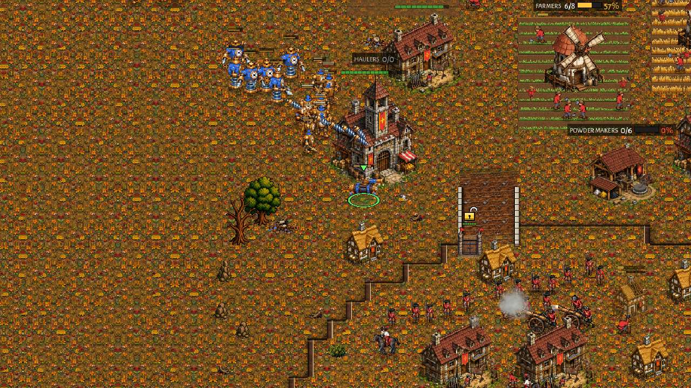
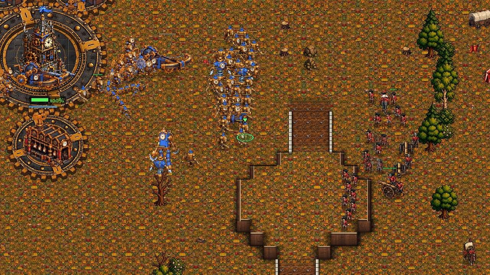
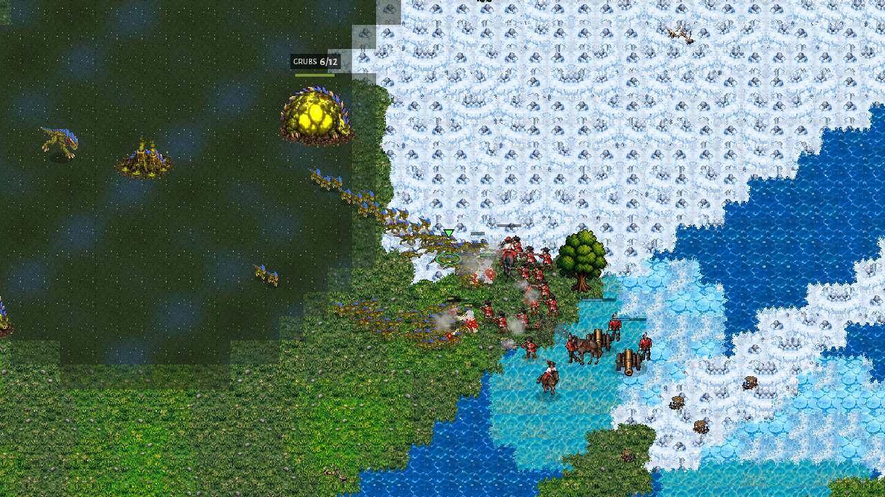

# The Crown's guns and line coached (crown-guns-coach, 2026-11-17)

The owner (2026-11-15 22:20, again 2026-11-16 23:25 "start all coaching jobs needed"): *"focus on wall making and microing
the army, screening with Horsemen, setting cannon before the engagement is very important, it doesn't help if the enemy
is on top of you and the cannon is still unlimbering, that is why Horseman screening is so important".*

A coaching job on the Crown computer's FIGHTING only (scripts/ai_crown_guns.gd `AICrownGuns`, hooks in
scripts/ai_crown_line.gd, ai_crown_screen.gd, ai_crown_hold.gd, ai_crown_mirror.gd, ai.gd): **no unit, price or rule number
changed**, every change behind a switch (`gunscoach:off` all of it; each rule its own, below). Branch crown-guns-coach from
main 0.38.38.

## In short

Measured with the win-rate design (19 maps x round 0/1, Hard OPTIMAL v Hard OPTIMAL, 12:00; 152 games, each game as is (A)
and with `gunscoach:off` (C) on the same map and seed; data docs/crown_guns_coach/data/, every table in
docs/crown_guns_coach/tables.md):

| (Crown's view) | arm | guns set at contact | guns firing in a fight's first 10 s | fights begun formed | kills per loss in fights | W-D-L | won or led |
|---|---|---|---|---|---|---|---|
| v Clockwork | A as is | **38%** | **65%** | 26% | **1.98** | 0-37-1 | 0 |
| v Clockwork | C off | 15% | 50% | 25% | 1.26 | 0-36-2 | 0 |
| v Brood | A as is | **33%** | **56%** | **44%** | **1.07** | 0-34-4 | 2 (6 even) |
| v Brood | C off | 20% | 37% | 21% | 0.88 | 0-33-5 | 5 (2 even) |

1. **The guns now fight.** Of the guns near a fight, those set up when it began went 15% -> 38% (v Clockwork) and 20% -> 33%
   (v Brood); those firing within its first 10 s 50% -> 65% and 37% -> 56%. At home the change is largest (set at contact
   13% -> 39% and 6% -> 31%): the guns at their posts now stand set up.
2. **The fights pay better.** In the Crown's fights it killed 1.98 for each 1 it lost v the Clockwork (was 1.26) and 1.07 v
   the Brood (was 0.88): +33,000 killed, -23,000 lost over 38 games v the Clockwork. The wave's fights out: 1.16 -> 1.67 v
   Clockwork, 1.32 -> 1.76 v Brood; begun formed v Brood 34% -> 70%.
3. **It shows a little in the army and the halls, not in the results.** The army at 10:00 is 0.55 of the enemy's (0.44
   off) v the Clockwork and 0.72 (0.61) v the Brood; built halls lost 0.74 -> 0.53 a game v the Clockwork, 0.79 -> 0.68 v
   the Brood. But paired game by game nothing is significant (outcome A better / C better: v Clockwork 2 / 1, v Brood 10 / 8;
   army 12:00 16 / 19 and 14 / 16), and the Crown still wins nothing: the gap is the economy and the army's size (income
   0.59 of the Clockwork's at 12:00, 0.70 of the Brood's), the other jobs' work (crown-brood-army, the coach).
4. **The ramp rule almost never fires** (1 stop at a foot in 76 games, 1 climb): the waves rarely march on a road into a
   ramp with nothing ahead; a column into a choke still happens when the line is already fighting or forming (choice 2).
   The screen's sightings did not rise (13 / 20 v Clockwork, 27 / 17 v Brood), and the guns' eyes (rule 8) fired 3 times:
   the screen was not where the gain came from.
5. No game failed, no script errors.

**Recommendation (Claude's):** merge (all rules on). The guns and the fights are clearly better in both matchups and no
measure got worse beyond noise. Next: the army's size v the Brood (crown-brood-army), and the wave's fights still begin
formed only a quarter of the time v the Clockwork (it is met at its bases at a few seconds' notice).

## What was wrong (with pictures)

The last measurement (docs/crown_coach_measure_2.md) found the guns set early in only 13-16 of 38 games, screen sightings
0.4 a game, and in its film crcw_highmoor_1104 the guns limbered behind the formed line and a wave climbing the
Clockwork's ramp as a column. Watching that film again, tracing the guns order by order (tools/bench_crown_guns.gd
`trace:1`, a stack print on every order a set gun got) and counting every fight (the new count, below) gave these causes:

1. **The wave's shared order loop took the guns back from the line.** The line (AICrownLine) hands its men back to the
   army's shared loop whenever it is not forming: in a fight, and in the coach's held line ("await", rule 6 of
   AICrownCoach). That loop sends every *idle* man on toward the enemy's base with an attack-move, and a gun that has just
   been told to set up, or is set with nothing in reach yet, is idle: it limbered again and rolled on. So the line formed,
   the guns were told to set up, and the next think sent them on, limbered. This is the picture from the last film:

   

   The held line was worse: "await" was not one of the line's states at all, so it fell through to the shared loop every
   think until it formed again 20 s later.
2. **The guns were 400-1,300 px behind the Musketeers at contact.** A Field Cannon walks at 38 px/s, a Musketeer at 62: on
   a march across the map the men drew away from their guns (benched: the guns 900-1,300 px behind the musket line at
   contact, on every run). The line's own close-up (SPREAD_MAX) did not see it: the guns were never in its "body" (12 tiles).
3. **The line's steps moved set guns.** A formed line steps toward the enemy with its guns until the enemy is in their
   reach (AICrownLine._step); each step gave every gun a move, also one already setting up: it limbered again.
4. **The guns stood just out of reach.** The line stops by its front rank (GUN_SET 330 px from the enemy) and the guns stand
   GUN_BACK (83 px) behind: 413 px, the edge of a 430 reach. Spread along the line, most of the guns set up 418-440 px off,
   could not fire, and the line walked on into musket reach.
5. **Nobody saw what the guns could reach.** A gun reaches 430 px, a Musketeer and a rider see 256. The screen's riders keep
   KEEP (360 px) off the enemy they have found, so once the line stood, an enemy on HOLD in the guns' reach was out of
   everyone's sight, and a gun cannot fire at what nobody sees.
6. **At home the guns stood limbered at their posts.** AICrownHold puts the guns of the ramp's top, the gate and the cliff
   edge on HOLD at their spots, limbered; a gun on HOLD sets up only once an enemy is in its reach: 2.5 s under fire.
   Counted in the films: home fights with guns near began with none set. A defence detachment's gun was also sent on into
   the raid's spot again and again (AI._defend's follow loop), limbered.
7. **The column up the ramp.** Nothing in the wave weighed a ramp: a wave whose road climbed onto the enemy's high ground
   walked up it in file into whatever stood at the top:

   
8. **The mirror's guns-at-the-hall rule pulled the line's guns away mid-fight** (AICrownMirror.guns_at_hall takes every
   gun within 900 px of the enemy hall to shell it, also the guns of a line fighting the enemy's army there).

## What changed (scripts/ai_crown_guns.gd; each rule its own switch, `gunscoach:off` all)

| rule | switch | what |
|---|---|---|
| 1. THE LINE KEEPS ITS GUNS | `gkeep:off` | the wave's shared loop leaves a gun of the standing line be (AI._line_keeps) |
| 2. THE GUNS SET IN TIME, UP TO REACH | `gset:off` | a line gun behind the front rank sets up where it stands once the nearest enemy known will be in its reach by the time it is set (distance less the enemy's closing speed x (2.5 + 0.8 s)); a set gun with an enemy in reach holds the line's steps (it is not moved again); a gun set or at its spot just out of reach goes up as far as its reach needs (never nearer than 1.2 tiles behind the front rank) |
| 3. THE GUNS FOLLOW THE LINE | `gfollow:off` | a set gun with nothing in reach, the enemy beyond reach + 150 and not coming on, 7 tiles behind the front rank, limbers and rolls up behind the line again |
| 4. THE HELD LINE | `gawait:off` | the coach's held line (its guns set, the enemy coming on) is a state of the line: it stands on HOLD, the fight at contact; the enemy no longer coming on (and the guns not shelling) for 4 s, or 25 s in all: it steps on |
| 5. THE WAVE KEEPS WITH ITS GUNS | `gpace:off` | while the wave marches with nothing in sight, a man more than 170 px ahead of his guns' middle stops (HOLD) till they are within 90 px, then goes on; the guns stuck 10 s: the men go on (20 s without) |
| 6. NO COLUMN UP A RAMP | `gramp:off` | a marching wave whose road climbs a ramp onto the enemy's high ground within 900 px stops 170 px short of the ramp's foot, its line facing up the ramp, the guns set behind it; it goes up only with 2x what it reckons up there (the enemy seen there in the last 90 s, or by the enemy's base what the enemy has less what it showed elsewhere, x 0.6); 45 s short of that it leaves the target be (as a lost trade: AI._bad_spots) and looks for another |
| 7. THE DEFENCE'S GUNS SET | `gdef:off`, `gpost:off` | a detachment's gun sets up where it is once an enemy is (or is about to be) in its reach and is not sent on into the raid's spot; a gun at its home post (ramp's top, gate, cliff edge) sets up there, and a set gun within 140 px of its post stays set |
| 8. THE GUNS' EYES | `gspot:off` | while the line stands with a gun set and an enemy known in the guns' reach that nobody sees, the screen's lead rider rides to 240 px of it (in its sight, 20 px outside the reach of what can shoot it, nothing fast near) and keeps it in sight; the line holds while its guns shell what they see (up to 25 s) instead of walking on into musket reach |
| (mirror) | `gkeep:off` | AICrownMirror.guns_at_hall leaves the guns of a line in its fight with the line |

Plus **the count** (read only, always on): every fight of the Crown's army (an armed enemy within 260 px of a Crown
soldier after 20 s of none there; worth 60+ of kills and losses), its guns within 1,000 px, how many stood set up at
contact, how many fired in its first 10 s, whether it began formed (a wave's line forming, stepping, set, held or advancing,
a ramp's foot, or a defence line laid in the last 30 s at home), what it killed and lost. In result.json `crown_ai` ->
`guns` (tools/qa_match.gd), and a story line at its end ("'s fight at 9:51 out (formed): 3 guns near, 2 set at contact, 3
fired in its first 10 s; killed 1,140, lost 380"). Unit.fired_t (the clock of a unit's last shot) is the only line added
outside the AI, read only.

## The bench (tools/bench_crown_guns.gd)

A Crown wave (12 Musketeers, 3 Field Cannons, 2 Horsemen for its screen) set out by the Crown computer's own wave loop
across the open middle of Greenhold toward the enemy's base, 1,300 px from an enemy force; the enemy's computer off, the
enemy doing what the scenario says (`clock` 14 Clock Soldiers coming on once the wave is within 1,000 px; `raptor` 24
Raptors the same; `hold` 12 Musketeers on HOLD across the road; `flank` 14 Clock Soldiers from the wave's flank; `home` the
army at home, 14 Clock Soldiers walking at it; `ramp` (Highmoor) 16 Clock Soldiers at the enemy's ramp top, scouted). 3 runs
each, off v on:

| scenario | runs | guns | set at contact off / on | fired in the first 10 s off / on | began formed off / on | killed off / on | lost off / on |
|---|---|---|---|---|---|---|---|
| clock | 3 | 9 | 0 / 0 | 0 / 5 | 3 / 3 | 2610 / 2800 | 50 / 110 |
| raptor | 3 | 9 | 0 / 4 | 0 / 4 | 3 / 2 | 1900 / 1750 | 170 / 170 |
| hold | 3 | 9 | 0 / 5 | 0 / 5 | 3 / 3 | 1620 / 2650 | 2440 / 950 |
| flank | 3 | 9 | 0 / 0 | 4 / 4 | 3 / 3 | 2200 / 2320 | 50 / 0 |
| home | 3 | 9 | 9 / 9 | 6 / 6 | 3 / 2 | 480 / 490 | 60 / 100 |
| **all** | 15 | 45 | **9 / 18** | **10 / 24** | 15 / 13 | 8810 / 10010 | **2770 / 1330** |

With the final code (b5): the guns fire in a fight's first 10 s 2.4 times as often (24 of 45 against 10), and the wave
loses half as much (1,330 against 2,770) for more kills. Against a musket line on HOLD the trade turns over (0.66 -> 2.79
killed per lost): the guns go up to their reach and shell it before the line walks into its fire. Against Clock Soldiers
coming on the guns are still not set at the very moment of contact (the enemy is first seen 560-780 px off and closes at
about 130 px/s with the line's own step) but are firing within 10 s in 5 of 9 (0 before). A ramp run on Highmoor, the
top's defence scouted: the wave stopped at the foot (each run), the Clock Soldiers came down into the line and its set
guns, 910-1,180 killed for 0-60 lost.

## The measurement

Arms A (as is) and C (`gunscoach:off`), tools/study/crown_guns_coach.py (each game's arms next to each other, two at a time
on a 2-core machine, Godot 4.7 headless, about 1.4 minutes of real time a game, 3.5 hours), report
tools/study/crown_guns_coach_report.py -> docs/crown_guns_coach/tables.md. Won or led and the ratios as in the win-rate
studies (a draw's leader: income earned + 2 x army value 10% ahead; ratios pooled, the Crown's over its enemy's).

| pairing | arm | income 5:00 | 8:00 | 10:00 | 12:00 | army 5:00 | 8:00 | 10:00 | 12:00 | built halls lost a game (Crown / enemy) |
|---|---|---|---|---|---|---|---|---|---|---|
| v Clockwork | A | 0.73 | 0.70 | 0.63 | 0.59 | 0.70 | 0.62 | **0.55** | **0.32** | **0.53** / 0.00 |
| v Clockwork | C | 0.73 | 0.69 | 0.61 | 0.58 | 0.72 | 0.67 | 0.44 | 0.26 | 0.74 / 0.03 |
| v Brood | A | 1.04 | 0.78 | 0.74 | 0.70 | 0.75 | 0.73 | **0.72** | 0.46 | **0.68** / 0.00 |
| v Brood | C | 1.03 | 0.79 | 0.76 | 0.73 | 0.72 | 0.72 | 0.61 | 0.41 | 0.79 / 0.00 |

Paired (A v C, sign test): v Clockwork outcome 2 / 1 / 35 same (p 1.0), income 8:00 higher in 22 / 16 (0.42), 12:00 22 / 13
(0.18), army 8:00 17 / 21, 10:00 22 / 16, 12:00 16 / 19; v Brood outcome 10 / 8 / 20 (0.82), income 8:00 16 / 22, 12:00
12 / 19 (0.28), army 5:00 18 / 12, 10:00 21 / 14 (0.31), 12:00 14 / 16.

The fights (real fights, worth 300+ of kills and losses; "set" and "fired" are shares of the guns within 1,000 px):

| pairing | arm | fights | begun formed | set at contact | fired in the first 10 s | fights where a gun fired (of those with one near) | killed / lost | per loss |
|---|---|---|---|---|---|---|---|---|
| v Clockwork, out | A | 32 | 31% | 37% | 80% | 75% | 52,935 / 31,660 | **1.67** |
| v Clockwork, out | C | 35 | 31% | 26% | 60% | 68% | 45,825 / 39,450 | 1.16 |
| v Clockwork, home | A | 72 | 26% | 39% | 59% | 71% | 118,350 / 54,660 | **2.17** |
| v Clockwork, home | C | 64 | 23% | 13% | 52% | 66% | 91,260 / 68,825 | 1.33 |
| v Brood, out | A | 27 | 70% | 32% | 65% | 75% | 43,655 / 24,785 | **1.76** |
| v Brood, out | C | 29 | 34% | 40% | 44% | 59% | 44,575 / 33,705 | 1.32 |
| v Brood, home | A | 54 | 35% | 31% | 55% | 69% | 79,420 / 90,170 | **0.88** |
| v Brood, home | C | 53 | 15% | 6% | 31% | 49% | 58,880 / 83,945 | 0.70 |

The rules fired (sums over 38 games, A): v Clockwork the line kept its guns from the shared loop 2,358 times, guns set in
time 67, up to reach 31, followed the line 14, the wave waited for its guns 43 times, set at their home posts 301, a
defence's guns 2, the guns' eyes 2, a ramp's foot 1 (climbed 1); v Brood 2,949 / 111 / 42 / 58 / 49 / 329 / 4 / 1 / 1 (0).
OPTIMAL's picks are the same in both arms (the fighting changes nothing before the first fight).

Two earlier runs of this measure were stopped and thrown away (kept out of the data): the first counted riders' skirmishes
as fights, the second had a ramp rule that never found a ramp (it looked only at the road's corner points).

## Films

tools/film_coach.gd shots:1 under xvfb-run, the final code, arm A, 12:00; the study game's map, seed and sides (a new game,
not a replay of the study's). Story, coach lines, the fight lines and the counters in docs/crown_guns_coach/films/<film>/.

- **crcw_highmoor_1104** (the film of the last measurement, again; the Crown P2): drawn, the Crown ahead in army at 12:00
  (3,090 against 2,590; the last film trailed, its army 0.25 of the Clockwork's at 12:00). The Clockwork's push at 8:17 meets
  the Crown at home: both its guns stand set on the high ground and fire in the first 10 s; 2,325 killed for 840:

  

  Its first wave (9:26) is met before it forms (9:30, 21 muskets deploy) and wins the field; at 10:20 it forms its line on
  the Clockwork's army 560 px off, the lead rider rides out to keep it in sight for the guns (10:38), and the line stands
  on the high ground at the top of the ramp with its three guns set behind it instead of going down it into the gears:

  

  That fight: 3 guns near, all 3 firing in its first 10 s, 3,695 killed for 895 (the last film's fights there lost the
  wave: 1,625 of army at 10:00, 900 at 11:00).
- **crbr_border_march_1121** (the Crown P2; the last film lost at 11:24): drawn, the Crown trailing in army (535 against
  960 at 12:00) but ahead in income (15,310 against 11,780) and with both halls. The Brood's push at 8:38 hits the walled
  natural: held, 840 killed for 100 (the last film: 33 Crown units and 10 buildings lost there, the natural's hall at 8:45).
  Still wrong: the home guns behind the palisade were not set at contact (the posts behind an attacked wall are laid again
  every few seconds); the first wave (10:00, 24 supply) is met at a ford by Raptors coming out of the swamp on its flank,
  unseen, one gun set and one still limbered; it falls back twice and wins the field, but meanwhile 42 Brood soldiers
  walk at the home it left with 360 of army:

  

### What the Crown still does wrong (coach's notes)

1. **Met from a flank it has not looked at** (the swamp, a ford): the screen rides the road ahead and its two flankers
   430 px out; the Brood's Raptors come out of fog and swamp at a few seconds' notice. A flank rider kept on the side of
   enemy ground (swamp, the enemy's base) would see it.
2. **v the Clockwork three fights in four still begin unformed**: most are at its bases, where its units come out of the
   buildings at a few seconds' notice (crown-rider-screen's note, unchanged).
3. **The posts behind an attacked palisade move every few seconds** (AICrownHold's wall plan): the muskets follow, the guns
   limber to follow (POST_SLACK 140 px keeps them only if the post moves little). A wall post laid once per attack would
   let the guns stand.
4. **Ramps**: the rule now sees a ramp on the wave's road, but a wave rarely marches into one with nothing in sight: it is
   usually already forming on or fighting what it saw at the top. A line forming before an enemy across a ramp should
   form at the foot, not on the far side of it (not built).

## Claude's choices (for the owner)

1. **Rule 5 (the wave keeps with its guns) slows every wave with guns to the guns' pace** (38 px/s, the Musketeer's 62):
   a wave reaches its target later. Chosen because a line that meets the enemy with its guns 1,000 px behind fights without
   them (rule 2 cannot set a gun that is not there). The alternative: the guns lead the march (they set up first, the men
   pass them) or the waves leave the guns home. Switch `gpace:off`.
2. **Rule 6 (no column up a ramp) reckons what stands at the top from what it has seen there in the last 90 s, or by the
   enemy's base 0.6 of the enemy's army it reckons (AICrown.foe_reckon) less what it has seen elsewhere**: a guess, not
   sight (it is what a player knows: he does not walk up a ramp into a base he knows holds the enemy's army). 2x to climb
   (CLIMB), 45 s at the foot then another target (FOOT_MAX). Against an enemy that does not come down, the wave now leaves
   that target be where it climbed before; it may never take a high main against a turtle (a siege with guns from the foot
   needs eyes on the top: a rider up the ramp, choice 4).
3. **Rule 2's "up to reach" moves a set gun when the enemy is just out of its reach and not coming on**: it limbers (2.5 s)
   and goes up at most to 1.2 tiles behind the front rank. Against an enemy that comes on in the meantime it is caught
   moving; I accepted that because the alternative (guns set 420-440 px off doing nothing while the line walks into musket
   reach) is what the films showed.
4. **Rule 8 (the guns' eyes) uses only the screen's lead rider and only on the level of the line**: no rider up a ramp or
   cliff to spot the top, no rider into the reach of an enemy shooter (20 px outside it; the rider is safe only while the
   enemy holds still). It fired little in the games (see the counters): the enemy is usually seen by the line itself by the
   time the guns are set.
5. **The held line (rule 4) waits at most 25 s** (AWAIT_MAX) and 4 s after the enemy stops coming on (AWAIT_STILL) before it
   steps on as before; while its guns are shelling something it keeps waiting (to 25 s).
6. **A gun at its home post sets up (rule 7)**, so it cannot follow a post that moves without limbering (2.5 s): a set gun
   stays set within 140 px of its post (POST_SLACK). test_crown_hold's [post] now reads "the cannon set up behind the line"
   (with `gpost:off` the old "on HOLD").
7. **The count leaves riders out of a fight's start** (as the line does: riders skirmishing ahead are not its fight) and
   fights worth under 60 out; a fight is "formed" if the wave's line was forming or formed (any of its states) or, at home,
   a defence line was laid in the last 30 s. A fight's guns are the Crown guns within 1,000 px of where it began; "fired in
   its first 10 s" is a shot in [start - 0.5 s, start + 10 s].
8. **The mirror (AICrownMirror.guns_at_hall) no longer takes the guns of a line in its fight** to shell the enemy hall: the
   line keeps them till its fight is over (gkeep).

## Tests

Run on the final code (Godot 4.7 headless): tools/test_crown_line, test_crown_hold, test_crown_defence,
test_crown_rider_screen, test_crown_mirror, test_crown_siege, test_crown_gate, test_crown_owner_eco, test_crown_v_brood,
test_ai_optimal: all pass. Earlier in the job (before the ramp road and the post tweak, which change neither's tests) the rest
of tools/test_crown_*.gd, test_cav_micro and test_charge_package: all pass but the two that fail on main too
(test_crown_dragoon_raid [plan], test_crown_stall [foundry]). test_crown_hold's [post] check now reads "the cannon set up
behind the line" (with `gpost:off`: "on HOLD", as before).

Tools: tools/bench_crown_guns.gd (the bench, `trace:1` prints the guns every second), tools/study/crown_guns_coach.py (the
measure), tools/study/crown_guns_coach_report.py (its tables).
