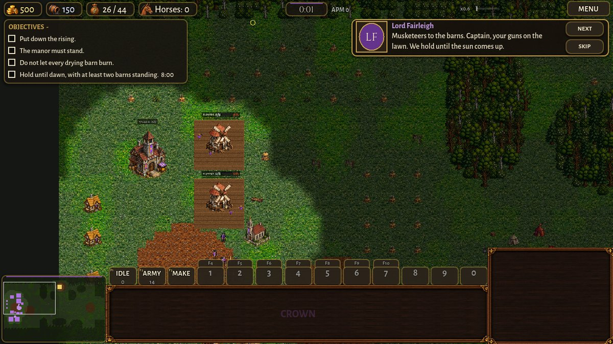
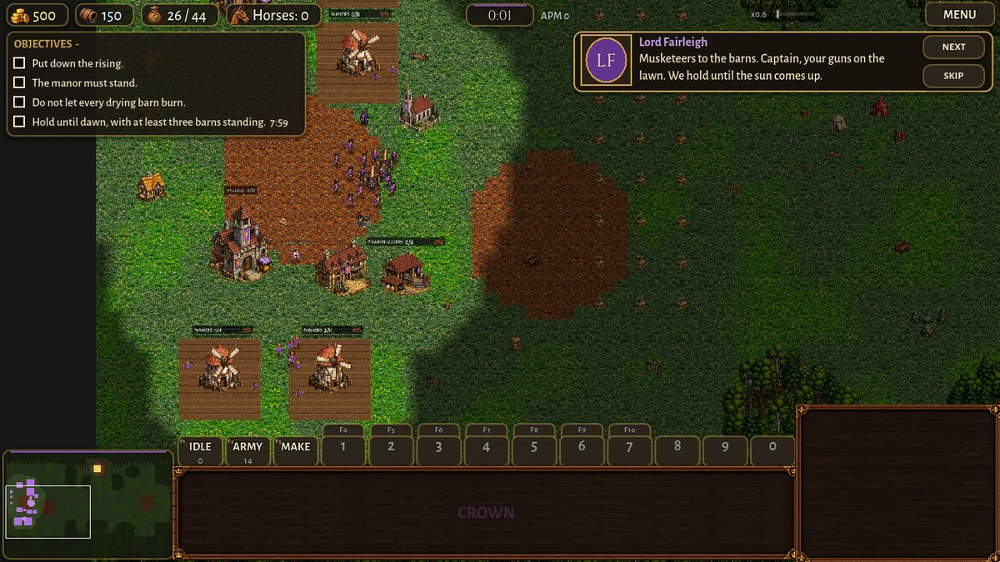

# eco-revert-prologue (0.38.12): the original economy back, the prologue's plantation on the 2-a-hall rule

The owner, 2026-11-15 10:24:

1. "I think we better revert back to 2 buildings, no radius, no effectiveness based on soil. Reverting back to original
   eco. Because currently this experiment is proving problematic."
2. The prologue's Governor had one Town Hall and five Farms, which "works against the player's instincts when they go from
   campaign to skirmish": "bring the Town Hall down and give it 2 Farms, and make another Town Hall a bit further north,
   still hugging the west, with 2 more Farms".

## 1. The economy: what was removed

The ORIGINAL economy is the only one: each Town Hall allows 2 Farms and each Clocktower 2 Cog Presses, counted empire-wide
(`Game.econ_limit` = 2 x halls), and a Farm / Press draws on its nearest hall's own soil / brass pool (`Building.soil`,
`Building.lode`); spent soil pays `SOIL_TIRED`, spent brass nothing. The rules are exactly those of 0.34.x (before the
ground system's merge, 0.35.0): `econ_count` counts every Farm / Press again, spent or not, and the limit is the side's,
not a district's.

Deleted (only the experiments used them):

- `scripts/ground_layer.gd` (GroundLayer: the soil / brass tiles, the districts, the circles, its save, net rows and study
  arguments) and `scripts/ground_view.gd` (GroundView: the layer while placing, its labels and minimap marks).
- `Defs.ground_on`, `Defs.ground_nocap`, `Defs.LAND`; `Defs.NOCAP_SUB`, `nocap_now`, `nocap_text` (the hall texts read "2
  Farms" / "2 Cog Presses" always).
- `Settings.ground_system`, `ground_nocap`, `ground_alpha` and their rows in Settings > EXPERIMENTAL (GROUND SYSTEM, NO
  FARM/PRESS LIMIT, GROUND LAYER WHILE PLACING). A saved "on" in the player's settings file is simply not read any more.
  EXPERIMENTAL keeps TURNING GEARS.
- In `Game`: `ground_layer`, `land()`, `ground_view`, the ground's spot score in `find_spot`, the circle draw in `harvest`,
  `harvest_value`, `lode_draw`, `lode_pay`, the district tick, `found` / `forget` / `covers_changed`; the NO FARM/PRESS
  LIMIT code (`econ_capped`, `is_ai_team`, `_nocap_limit`, `nocap_allow`, `nocap_extra`, `_district_live`), the local
  (district) limit and the "No soil here" / "No brass here" refusal (`NO_GROUND_MSG`): a Farm away from every hall says
  "Must be near your Town Hall." again.
- In `Building`: the ground branches of `soil_left`, `lode_left`, `barren` and `press_rate`.
- The computers: `AI._ground_recycle` (pulling down a Farm / Press on a spent circle), `AI.nocap_hands` (worker caps grown
  by the extra crews) and its use in `AICrown.owner_lab_cap`; `GearEcon.room_spot_n`'s ground score. The paths left are the
  ones every computer ran with the ground off (the default): spent Mills / Crushers / Presses pulled down by
  `_recycle_spent`, spent Farms by the Crown computer's own rule (econ-coach-crown, 0.34.2, older than the ground system).
- The HUD: the build card's "Farm 3" (no limit) label and "no limit: the ground decides" line; the hall info lines without
  `nocap_text`; the minimap's ground marks.
- Online: the snapshot's ground rows ("gk" / "gd"), `NetView.ground_sent`, `NetSession.ground_sent`.
- Tools: `tools/test_ground_system.gd`, `test_ground_nocap.gd`, `shot_ground_system.gd`, `ground_probe.gd`,
  `tools/study/ground_games.py`, `ground_nocap.py`, `ground_nocap_bench.py`, `econ_nocap_all.py`,
  `econ_nocap_all_bench.py`; the `ground=` / `groundcap=` / `drink=` / `land.<key>=` arguments of `econ_bench.gd`,
  `econ_ai_alone.gd`, `econ_ai_alone_brood.gd`, `qa_match.gd`, `shot_ai_match.gd`; `qa_matches.py --only ground`;
  `test_net_fog.gd`'s `ground:1` mode (back to its 0.34 form); the ground parts of `test_overlay_alpha.gd` (parts B and C
  now check the original texts and refusal), `test_settings_tabs.gd`, `test_qa_settings_persist.gd`.
- Texts: `tools/i18n/65_ground_system.txt`, `68_ground_nocap.txt` and the hall-text / refusal entries of
  `69_overlay_alpha.txt` (the lang tables rebuilt: 37 entries fewer each). The old patch notes stay as history.
- Docs: `docs/ground_system.md`, `ground_system_games.txt`, `ground_nocap_study.md`, `econ_nocap_all.md`, their data
  folders and pictures (`docs/ground_nocap_data/`, `docs/econ_nocap_all_data/`, `docs/shots/ground_system/`,
  `ground_nocap/`, `econ_nocap_all/`, about 22 MB). They are in the git history: `git show 42ae6314:docs/ground_system.md`
  (0.38.11, the last version with them).

Kept, because other systems use them or they are not the experiment's:

- `Game.halls_of`, `nearest_hall`, `soil_hall`, `lode_hall`, `soil_scars`, `ECON_RANGE`, `HALL_SPACING`: the original economy.
- OVERLAY OPACITY (`Settings.overlay_alpha`, part A of overlay-alpha): unrelated to the ground.
- `qa_match.gd`'s Farm / Press count per hall (`_drinkers`) and its army-at-home share (`_home_share`): plain measures that
  work without the ground.
- The Brood's Rootmaw ground (`BroodNew`, `GroundMarks`, "ATTACK GROUND"): other systems that share the word.

Old saves, replays and online setups: a match setup's `"ground"` / `"ground_nocap"` is erased when a match starts
(`Main.start`), a save's `"ground"` block is not read (`SaveGame`), a MIXED replay's keyframes likewise (`ReplayMix`). Such
a match goes on with the original economy: the halls' soil and brass were saved with them (the ground system kept them up
to date as each district's total), so a hall reads what its district held. A match played with NO FARM/PRESS LIMIT keeps
the Farms it already built over the limit; it just can't build more. Nothing is refused.

### The benches with the original economy (0.38.11 = main, ground off; 0.38.12 = this branch)

| Bench (greenhold, seed 1) | 0.38.11 | 0.38.12 |
|---|---|---|
| `econ_bench.gd crown` (scripted), value by 10:00 | 14,079 | 14,079 |
| `econ_bench.gd clockwork` (scripted), value by 10:00 | 14,863 | 14,857 |
| `econ_ai_alone.gd crown` (the computer, OPTIMAL Hard), value by 10:00 | 11,897 | 12,296 |
| `econ_ai_alone.gd clockwork`, value by 10:00 | 17,522 | 17,639 |
| `econ_ai_alone_brood.gd`, value by 10:00 | 13,948 | 13,988 |

The scripted benches are the same. The computers alone are within 0-3% (the Crown's halls came 2 s apart; its plans,
halls and buildings at 10:00 are the same: 4 halls, 8 Farms, 4 Mills): the one rule that changed with the ground off is
that a spent Farm / Press counts against the limit again (0.35.0 had stopped counting it even with the ground off, and had
made the limit each hall's own), which the computers already handle by pulling spent ones down.

## 2. The prologue's plantation (campaign/missions/p01_leaf.json, map campaign:virginia_leaf)

Before: one Town Hall (the manor, tag `manor`) at [10, 34] and five Farms (tag `barns`). Now (cells, top-left corner):

| Building | Was | Now |
|---|---|---|
| Town Hall, the manor (tag `manor`) | [10, 34] | [8, 42], further south |
| Town Hall to the north (new, tag `north_hall`) | - | [8, 23], on the west side; 19 tiles from the manor (HALL_SPACING 18) |
| Farms (tag `barns`) | [24, 30], [24, 38], [6, 22], [14, 22], [20, 48] | north hall: [16, 20], [16, 27]; manor: [6, 50], [14, 50] |
| Church (the chapel) | [18, 28] | [22, 32], between the north barns and the lawn |
| Barracks, Powder Mill | [8, 44], [16, 44] | [16, 44], [21, 44], beside the manor |
| Cottages | [3, 29], [3, 33], [3, 41] | [3, 29], [3, 33], [3, 38] |

Every barn stands within ECON_RANGE of its hall, two by each (checked in `tools/test_campaign_m1.gd`), so the Governor
starts at the Farm limit (4 of 4) exactly as a skirmish player would with two halls. Units: Lord Fairleigh by the manor's
steps [14, 44], Tomasz by the chapel [19, 34], the labourers [14, 47], the guns on the lawn [20, 38] (co-op's gunners
[21, 40]); the 10 Musketeers on the lawn as before. Areas: `plantation` [3, 16, 30, 42] (all of it; the night waves
attack-move on it), `manor` [6, 38, 18, 10] (the dawn reinforcements arrive there), `lawn` [15, 35, 8, 8] (the camera and
the line). `edge_n`, `edge_e`, `edge_ne`, `edge_se`, `edge_s` (where the waves come out of the woods) are unchanged: the
north barns face the north fields and the first waves, the manor and its barns the south and south-east ones. The map's
props were moved off the new footprints (a drying rack, a barrel, the sacks, the bench); its tobacco fields north and south
are where they were, so each hall has its barns between it and a field.

The objectives keep their words ("The manor must stand.", "Do not let every drying barn burn.", "Hold until dawn, with at
least three barns standing."); the first-barn line now comes at 3 barns left (below 4, was below 5). CLAUDE'S CHOICE:
dawn still needs THREE barns, now of four. The night's balance sim (`tools/sim_campaign_m1.gd`, the "active" bot that hunts
torch-bearers, 3 runs) ended the night with 3, 3, 3 barns of 5 before and 4, 3, 4 of 4 now: the plantation is more compact,
so "three" keeps it as close a run as it was (two of four would have made it much easier). A passive player now loses at
5:51 (the manor burns; it was 4:39, the barns). The opening's stills and lines name no number of farms, so nothing
contradicts the map. The story plays as before (`tools/test_campaign_m1.gd` and `tools/test_campaign.gd`: 0 failures):
the waves reach both halls, the families choice and the canister ending are untouched (they are far east).

Also fixed (seen in the pictures): a mission with `"expansion_spots": false` showed an OPTIMAL EXPANSION SPOT again once its
Crown side had two halls (the Crown's and the Clockwork's own spot rules re-rated the spots when the halls changed); now the
mission's choice turns those updates off too (`Game`, `ExpansionSpots.crown_on` / `clock_on`). The 0.31 picture of the night
showed it too.

## Tests (0.38.12; headless Godot 4.7, each also run on main 0.38.11 where it failed)

Pass: test_files (1310 checks), test_content_all (0 FAIL checks, the 16 WARNs as before), test_unit_stats,
test_card_text, test_i18n (4870 pt / es entries, 0 data texts untranslated), test_settings_tabs, test_qa_settings_persist,
test_overlay_alpha, test_campaign, test_campaign_m1 (with the new layout checks: two halls 19 tiles apart, 2 barns each
within reach, the Farm limit at 4 of 4), test_net_fog (back to 0.34's form), test_ai_abandoned_site, _air_defence,
_army_response, _brood, _crown_bank, _expand, _expand_wall, _gg_rule, _harass, _optimal, _placement, _r5_hold_spots,
_round6, _round6_stall, _scout, _scout_defence, _scout_sentry, _scout_threat, _wall_vs_rush, _worker_safety,
test_crown_ammo, _balloon, _balloon_coach, _build_order, _defence, _farms, _gate, _ghosts, _hold, _line, _lost_hall,
_owner_eco, _rider_screen, _siege, _stall, _v_brood. Booting the game headless (900 frames): no SCRIPT ERROR.

Fail, and fail on main too (known flaky or stale in CLAUDE.md):

| Test | 0.38.12 | 0.38.11 (main) |
|---|---|---|
| test_ai_cw_horse_raid | 1 failed (round 5 lost 3 -> 9 Winders) | 2 failed |
| test_ai_rush | "workers before the Brood Mother" (Mother hit at 3:55, first grub 3:58 / 4:03), 3 runs of 3 | the same, 1 run of 2 (the other passed: grub 4:05, Mother 4:34) |
| test_ai_rush_followup | 14 failed | the same checks fail |
| test_cinder_crown | [hall] second hall by 330 s (348-349 s) | the same (346 s) |
| test_crown_dragoon_raid | [plan] a group out by 690 s (rode false) | the same |
| test_crown_mirror | 1 failed in the first run (a Musketeer queued for the raider at 12.0 s), passed on the rerun | passed |

test_campaign and test_campaign_m1 print SCRIPT ERRORs ("Invalid assignment of property 'name' ... on Nil", 10 and 16 of
them) on main too: a campaign test-harness matter, not this job's.
