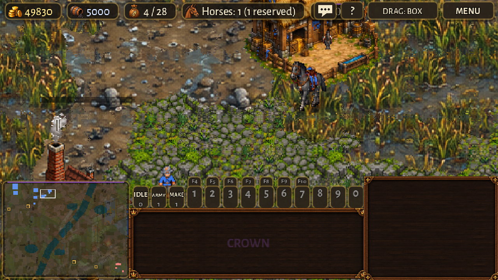
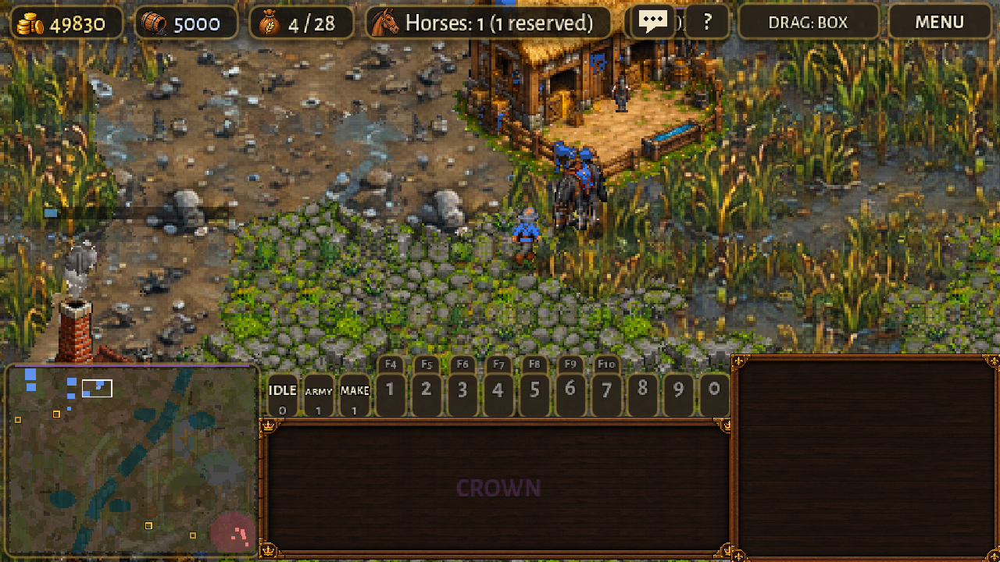
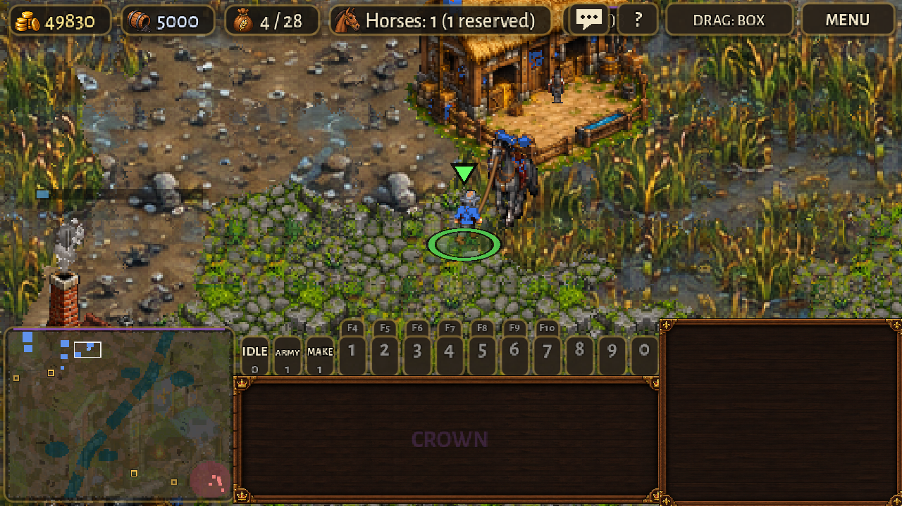
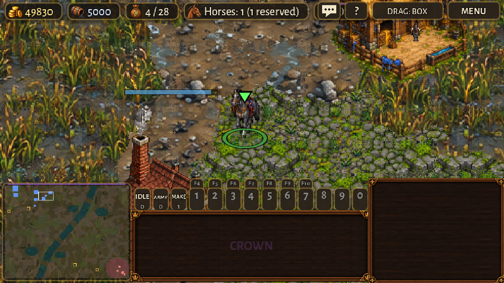
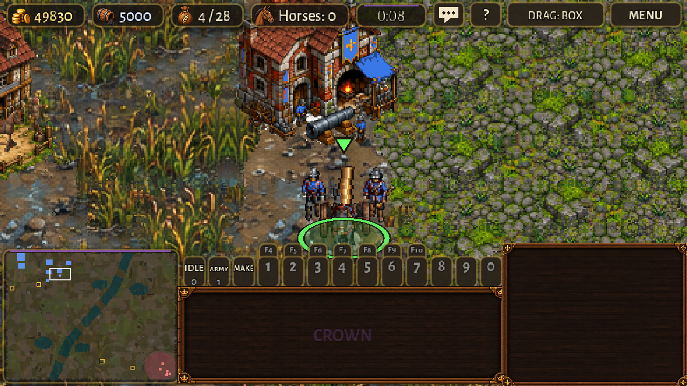
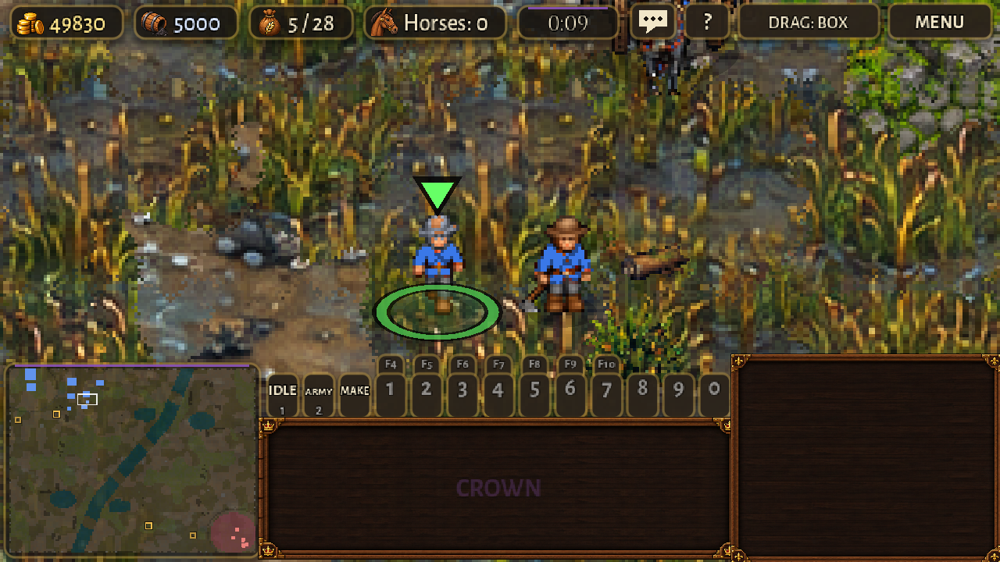

# The Gun Crewman: a horse never walks to the Foundry by itself (gun-crew-fetch, 0.38.87)

## What the owner asked (2026-11-20 08:34)

"If we don't have haulers and we train a cannon the horse goes from the horse breeder to the foundry alone. This is not
supposed to be like this. Horses are not supposed to go alone. Without a hauler the cannon operator should go from the
foundry and get the horse on a leash back to the foundry."

## What happens now

A Field Cannon, Mortar or Powder Wagon needs a horse. As before, one click trains both: a free horse at a Horse Breeder
is kept for the gun, or the breeder trains one (40 gold more). The horse now WAITS at the breeder. Then:

- **A Town Hall hauler is free:** he fetches it on the leash and hitches it by the Foundry, as before.
- **No hauler is free (or there are none):** a **GUN CREWMAN** comes out of the Foundry. He walks to the breeder (if the
  horse is still being bred he waits by the breeder until it comes out), takes it on the leash (the haulers' leash,
  drawn the same way), leads it back, hitches it beside the Foundry and goes back inside. The gun then rolls out drawn by
  that horse.

The rules:

- **One crewman per gun.** A crewman also brings the Foundry's next guns' ready horses along when they stand within
  HAUL.batch (8) tiles of his, up to HAUL.horses (4), like a hauler.
- **A hauler takes over if he would be quicker:** while the crewman is still walking to the horse (or waiting at the
  breeder), a free hauler nearer to it than him (by 2 tiles) takes the job and the crewman goes back in.
- **He can be killed** (46 health, unarmed). The horse stays where it is, still kept for its gun; another crewman comes
  out 4 s later (GunCrew.CREW_WAIT), or a hauler takes it if one is free.
- **Cancelling the gun** lets the horse go where it stands (free again, grazing) and he walks back in.
- **His Foundry destroyed:** he lets the horses go and walks into the nearest Foundry or Town Hall (none left: he is gone).
- **He can't be picked or ordered:** clicking or boxing him picks his Foundry (like a Spring Ballista's crewman picks the
  Ballista). He is in no army list, no worker list and no supply count (supply 0), and he takes nobody's horse.
- **Haulers too** now lead a horse right up to its own spot beside the building (Game.hitch_spot, the nearest good one)
  and it is hitched on that spot, instead of being let go at the building's edge and walking the last steps (up to
  ~3 tiles round the building) by itself.

The Brood and the Clockwork have no horses: untouched.

## Every place a horse went to a building (or a gun) by itself

| Where | Before | Now |
|---|---|---|
| `Game._reserve_horse` (a spare horse kept for a gun) | walked to the Foundry when no hauler was free | stays at the breeder; a hauler or a Gun Crewman fetches it |
| `Game.fetch_reserved` (the gun is ready, its horse isn't there) | walked to the Foundry | only makes sure a horse is kept (a new one if it was killed or stolen); the fetching is GunCrew's / the haulers' |
| `Game._spawn_trained` horse branch (a horse bred for a gun, ~4994) | walked to the Foundry | stays at the breeder (same as above) |
| `Game.train`, a free horse **already at the building** (within HORSES.at_building, 2 tiles, ~4784) | walks the 2 tiles to its hitch spot | kept: it is already at the building (no trip from the breeder) |
| `Unit._hitch` (a hauler / crewman lets go) | let go within 30 px of the building's edge, the horse then walked round to its spot | he leads it to the spot; it is hitched there |
| `Game._horse_command` (right-click a gun with a horse selected or led, ~11846) and `Game.harness_order` (HARNESS, ~11906) | the horse walks to the GUN | kept: the player orders it, and the destination is a gun in the field, not a building |
| `AI` spare team horse (ai.gd ~8589: a second horse for a gun near a hall) | walks to the GUN | kept: a gun, not a building; with haulers the AI already asks them (team_want). A possible follow-up: a crewman out of the gun's team |

## Saves, replays, online

- A crewman is **not saved**. A horse on his leash is saved with its reservation (as a free horse kept for the gun), and
  after the load a new crewman comes out of the Foundry for it (GunCrew.dispatch every 0.5 s). Replays' keyframes are
  saves: the same.
- **Online**, the host runs everything (GunCrew lives in the host's simulation); the guest sees the crewman as any unit
  from the snapshots, drawn with his own strips. On the guest he can't be picked (his Foundry isn't known there: the pick
  is dropped).

## The art

A stand-in: the Labourer's strips with his brown hat recoloured a steel grey like the gunners' morions
(tools/make_gun_crew_art.py -> assets/units/gun_crew/, GunCrewArt merged into ArtData.UNITS); the red coat is the
team-colour mask, so he wears the side's colour like the crew painted on the guns. Listed in
docs/art_style_inconsistency.md for a ChatGPT gunner.

A frame a second in docs/shots/gun_crew_fetch/film/ (tools/shot_gun_crew_fetch.gd).

## Code

- `scripts/gun_crew.gd` (GunCrew): `dispatch` (from Game.haul_dispatch, every HAUL.scan s, after the haulers), `send`,
  `tick` (Unit order "gun_fetch"), `_hand_over` (a quicker hauler), `go_home`, `on_death`.
- `Unit.fetch_home` (his Foundry), `Unit.hitch_pref` (the spot a horse was led to: Game.hitch_horse takes it);
  `Unit._haul_horses` "deliver" leads the horse to `Game.hitch_spot(b, h, 3.0)` (near_w: the nearest good spot).
- `Defs.UNITS.gun_crewman` (campaign_only and "from": "": trained nowhere, no lobby lists him), `Defs.LEADERS`,
  `Defs.TEMP_ART`; `Game.army` and `Game.set_selection` leave him out; `SaveGame.capture` skips him; `Unit.can_steal` no.
- Texts (en/pt/es): the Foundry's card and tip, the Town Hall's and the Labourer's, the help page on horses; the crewman's
  name and card (tools/i18n/76_gun_crew.txt).

## Tests

- `tools/test_gun_crew_fetch.gd` (new): no haulers (the crewman comes out by the Foundry, is in no list, picking him picks
  the Foundry, takes the horse on the leash, hitches it, goes back in, the cannon comes out on that horse's coat); a horse
  being bred (a Mortar: he waits by the breeder); a hauler free (a Powder Wagon: no crewman); the crewman killed (the
  horse stays, a new one comes, the gun comes); cancelled (the horse let go where it stands, he goes back in); a far
  breeder behind a wall with a gate (both ways through it); two guns (one crewman, both horses); a save while he is out
  (he isn't in it, the horse is, with its reservation); and every tick: no horse kept for a building ever walked to it by
  itself more than 80 px from it (its last steps from its leader's side to its spot are allowed). ALL PASS.
- Updated for the new rule: `test_horses` (the gun's horse waits at the breeder and a crewman leads it) and
  `test_haulers` ("no hauler" and "every hauler busy": a crewman goes; a freed-horse lookup reordered).
- Pass: test_horse_vanish, test_horses, test_haulers, test_haul_fallback, test_horse_deliver, test_horse_leash,
  test_horse_gate, test_limber_gate, test_haul_pocket (now 4.9 s, was ~7), test_horse_care, test_loose_horses,
  test_cliff_horse, test_gate_lock. The Crown AI tests: see below.
- `tools/audit_horses.gd` gained ALONE (a horse walking to a building by itself, led by nobody, more than 80 px from it),
  crewmen counted, a Gun Crewman making no headway as LEAD STUCK (not while he waits by the breeder), and GUN WAIT (a
  Foundry gun ready but waiting over 60 s for its horse); a 5th argument picks the Crown computer's plan (siege for guns).

AUDIT_RESULTS

## Claude's choices (for the owner to confirm)

1. **A new unit, not a Labourer.** The crewman is his own kind (`gun_crewman`), so no worker job, AI plan, idle-worker
   button or supply count ever takes him; he only exists between leaving the Foundry and going back in.
2. **Not selectable, not orderable:** picking him picks his Foundry (as with the Ballista's crew). Letting the player
   order him would make him a free unarmed scout out of every Foundry.
3. **The stand-in art** is the Labourer with a steel helmet; the guns' painted crew would need a new ChatGPT sheet.
4. **He waits at the breeder** while the horse is bred (he leaves the Foundry at once, like the horse used to): the gun is
   no later than before, and the player sees why the gun waits.
5. **4 s before a new crewman** after one is killed, so an enemy at the breeder doesn't get a stream of them at once.
6. **Haulers lead the horse to its hitch spot too** (the same rule: no horse goes alone, even round the building). A side
   effect: the Barracks' pocket test is quicker (the nearest good spot is chosen for a led horse).
7. **The guns' extra team horses** (HARNESS, right-click, the computer's second horse for a gun) still walk to the GUN:
   those are orders to a gun in the field, not to a building. Say if those too should have a leader.
8. **The crewman is not saved:** a new one comes out after a load (simpler, and nothing is lost: the horse keeps its
   reservation).
9. **His deliveries count as hauled horses** in the match statistics (the haulers' code counts them).
